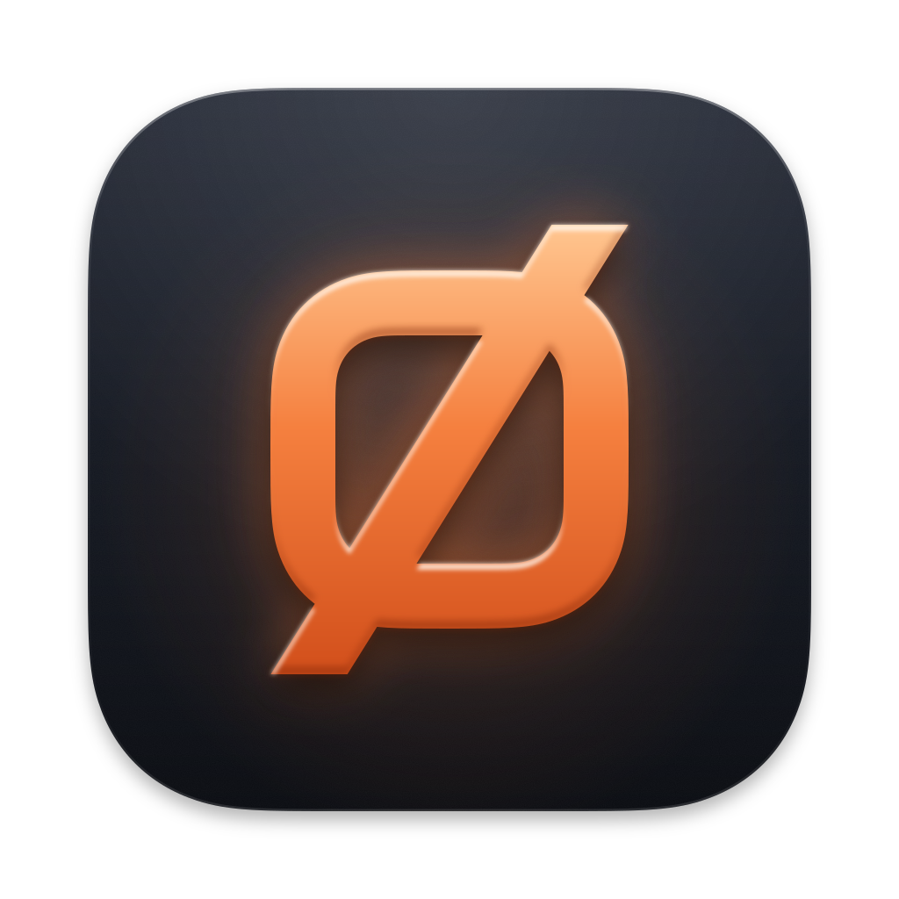

<div align="center">

<br/>

<a href="https://github.com/mrz1836/nilbox"></a>

# Nilbox

**Your GitHub inbox, set to nil.**

One inbox for every repository you touch.<br/>
One click to hand any pull request or issue to a coding agent.

<br/>

<a href="https://github.com/mrz1836/nilbox/releases"></a>
<a href="https://golang.org/"></a>
<a href="#-installation"></a>
<a href="https://github.com/mrz1836/nilbox/blob/master/LICENSE"></a>

<br/>

<table align="center" border="0">
  <tr>
    <td align="right">
       <code>CI / CD</code> &nbsp;&nbsp;
    </td>
    <td align="left">
       <a href="https://github.com/mrz1836/nilbox/actions"></a>
       <a href="https://github.com/mrz1836/nilbox/actions/workflows/frontend.yml"></a>
       <a href="https://github.com/mrz1836/nilbox/actions"></a>
    </td>
    <td align="right">
       &nbsp;&nbsp;&nbsp;&nbsp; <code>Quality</code> &nbsp;&nbsp;
    </td>
    <td align="left">
       <a href="https://codecov.io/gh/mrz1836/nilbox"></a>
    </td>
  </tr>

  <tr>
    <td align="right">
       <code>Security</code> &nbsp;&nbsp;
    </td>
    <td align="left">
       <a href="https://scorecard.dev/viewer/?uri=github.com/mrz1836/nilbox"></a>
       <a href=".github/SECURITY.md"></a>
    </td>
    <td align="right">
       &nbsp;&nbsp;&nbsp;&nbsp; <code>Community</code> &nbsp;&nbsp;
    </td>
    <td align="left">
       <a href="https://github.com/mrz1836/nilbox/graphs/contributors"></a>
       <a href="https://mrz1818.com/"></a>
    </td>
  </tr>
</table>

</div>

<br/>
<br/>

<div align="center">

### <code>Project Navigation</code>

</div>

<table align="center">
  <tr>
    <td align="center" width="33%">
       🚀&nbsp;<a href="#-installation"><code>Installation</code></a>
    </td>
    <td align="center" width="33%">
       ⚡&nbsp;<a href="#-quick-start"><code>Quick&nbsp;Start</code></a>
    </td>
    <td align="center" width="33%">
       ✨&nbsp;<a href="#-features"><code>Features</code></a>
    </td>
  </tr>
  <tr>
    <td align="center">
       🧭&nbsp;<a href="#-how-it-works"><code>How&nbsp;It&nbsp;Works</code></a>
    </td>
    <td align="center">
       📚&nbsp;<a href="#-documentation"><code>Documentation</code></a>
    </td>
    <td align="center">
       🧰&nbsp;<a href="#-development"><code>Development</code></a>
    </td>
  </tr>
  <tr>
    <td align="center">
       🔐&nbsp;<a href="#-security"><code>Security</code></a>
    </td>
    <td align="center">
      🛠️&nbsp;<a href="#-code-standards"><code>Code&nbsp;Standards</code></a>
    </td>
    <td align="center">
      🧪&nbsp;<a href="#-examples--tests"><code>Examples&nbsp;&&nbsp;Tests</code></a>
    </td>
  </tr>
  <tr>
    <td align="center">
      🤖&nbsp;<a href="#-ai-usage--assistant-guidelines"><code>AI&nbsp;Usage</code></a>
    </td>
    <td align="center">
       🤝&nbsp;<a href="#-contributing"><code>Contributing</code></a>
    </td>
    <td align="center">
       👥&nbsp;<a href="#-maintainers"><code>Maintainers</code></a>
    </td>
  </tr>
  <tr>
    <td align="center" colspan="3">
       ⚖️&nbsp;<a href="#-license"><code>License</code></a>
    </td>
  </tr>
</table>

<br/>
<br/>

**Nilbox is a local-first macOS app that turns a GitHub account spread across hundreds of
repositories into one focused inbox. It shows what needs *you*, hides the noise, lets you review
and merge without leaving it, and opens any pull request or issue in Claude Code or OpenAI Codex,
already in the right clone, worktree, account, and prompt.**

GitHub's notifications stop scaling after a few dozen repositories. Across 200+ repos in personal
accounts and organizations, review requests, mentions, assignments, and bot noise land in one
unranked pile, and acting on any of it means a context switch: find the clone, check out the
branch, open a terminal, start an agent, retype the prompt. Nilbox handles both: it filters out
the noise, and it launches the agent for you. It then keeps the worktrees those agents leave
behind tidy, and, if you use mage-x or go-pre-commit, releases your repositories and runs their
hooks and scripts too. Your triage state stays on your machine and never touches GitHub.

<br/>
<br/>

```
                                   YOUR MAC
  ┌─────────────────────────────────────────────────────────────────────────┐
  │                                                                         │
  │  ┌──────────────────────────────┐        ┌───────────────────────────┐  │
  │  │  NILBOX                      │        │  iTerm2 / Terminal.app    │  │
  │  │                              │        │                           │  │
  │  │  Inbox      triage · review  │  Open  │  worktree pr-42 of        │  │
  │  │  Worktrees  track · clean up │   in   │  example-repo             │  │
  │  │  Prompts    your templates   │ Claude │  claude  or  codex        │  │
  │  │  Scripts    release · hooks  │───────►│    profile · model ·      │  │
  │  │                              │or Codex│    effort · your prompt   │  │
  │  │                              │        │                           │  │
  │  │  local SQLite, never sent    │        └───────────────────────────┘  │
  │  └───────────────▲──────────────┘                                       │
  │                  │                                                      │
  └──────────────────┼──────────────────────────────────────────────────────┘
                     │  GraphQL + REST reads, and the edits you ask for
                     │  your gh CLI token, held in memory
            ┌────────┴─────────┐
            │  api.github.com  │
            └──────────────────┘
```

<br/>

## 🚀 Installation

Nilbox is a native app for macOS 13 or newer, on Apple silicon and Intel. Linux and Windows are on
the [roadmap](#support--roadmap).

### Install

Paste this into Terminal:

```bash
(cd "$(mktemp -d)" &&
  curl -fsSLO https://github.com/mrz1836/nilbox/releases/latest/download/Nilbox.dmg &&
  hdiutil attach -nobrowse -quiet -mountpoint "$PWD/mnt" Nilbox.dmg &&
  rm -rf /Applications/Nilbox.app &&
  ditto mnt/Nilbox.app /Applications/Nilbox.app &&
  hdiutil detach -quiet mnt &&
  open /Applications/Nilbox.app)
```

It downloads the latest release, puts Nilbox in Applications, and opens it, with no security
prompt to click through.

- **Quit Nilbox first** if it's already open: the command replaces the copy in Applications.
- **On an account that can't write to `/Applications`** (a standard user), install it in
  `~/Applications` instead:

  ```bash
  mkdir -p ~/Applications
  (cd "$(mktemp -d)" &&
    curl -fsSLO https://github.com/mrz1836/nilbox/releases/latest/download/Nilbox.dmg &&
    hdiutil attach -nobrowse -quiet -mountpoint "$PWD/mnt" Nilbox.dmg &&
    rm -rf ~/Applications/Nilbox.app &&
    ditto mnt/Nilbox.app ~/Applications/Nilbox.app &&
    hdiutil detach -quiet mnt &&
    open ~/Applications/Nilbox.app)
  ```

Nilbox borrows the [GitHub CLI](https://cli.github.com)'s sign-in (the `repo` and `read:org`
scopes, plus the optional `read:project` to see the projects your issues are in), and launches the
Claude Code CLI (`claude`), the Codex CLI (`codex`), or both, in iTerm2 or Terminal.app. Its
first-run setup checks each one and gives the command for anything missing.

<br>

### Or download the disk image

Download [Nilbox.dmg](https://github.com/mrz1836/nilbox/releases/latest/download/Nilbox.dmg). A
release is signed but not notarized by Apple, so macOS asks you to approve it once:

1. Open `Nilbox.dmg`. If macOS says it can't verify it, click **Done**, then go to **System
   Settings → Privacy & Security**, click **Open Anyway**, and confirm.
2. Drag **Nilbox** into **Applications**.
3. Open Nilbox from Applications. If macOS asks again, this time about the app, approve it with
   **Open Anyway** the same way.

This happens once, at install: updates never ask. Since macOS 15, Control-click → **Open** no
longer gets past the warning, so these steps go through System Settings.

<br>

### Updates

A release updates itself. About a minute after it opens, then every 6 hours, it checks GitHub for a
newer release, downloads it quietly, and, when you click **Restart to update**, backs up your data
and restarts into it. **Settings → About → When a new version is out** chooses *Download it and
tell me* (the default), *Just tell me*, or *Don't check*, and the menu bar's **Check for
Updates…** checks at once ([how updates work](docs/desktop.md#updates)).

Opened on data a newer version saved (after running a build from source, say), Nilbox leaves the
data untouched and offers **Update and Reopen**, which installs the latest release and opens it;
when no release is newer yet, it says so and gives the command to build from source.

<br>

### Build from source

To build Nilbox yourself, you need:

- **macOS 13+** with the Xcode Command Line Tools (`xcode-select --install`)
- **[Go](https://go.dev/dl/) 1.26+**, **Node 26**, and **pnpm** at the pinned version (`npm install -g pnpm@12.19.0`)
- **[MAGE-X](https://github.com/mrz1836/mage-x)**: `go install github.com/mrz1836/mage-x/cmd/magex@latest`
- The **GitHub CLI** and a coding agent, as above

```bash
git clone https://github.com/mrz1836/nilbox.git && cd nilbox
magex app:run      # build "bin/Nilbox Dev.app" and open it
```

A build from source is **Nilbox Dev**, with a bundle ID of its own (`com.mrz1836.nilbox.dev`), so
macOS keeps it apart from the release: Spotlight, notifications, privacy prompts, and Open With
list the two separately. It still shares the release's data: your settings, prompts, launch
defaults, and triage are the same in both. Don't run the release and Nilbox Dev at the same time,
since both would sync and write the same database: quit one before you open the other.

A build from source never updates itself: to update it, pull, then run `magex app:run` again.
`magex app:open` reopens the build as it is. The Wails CLI is never installed: the build runs it
with `go run` at the version `go.mod` pins. Every other `magex` command is listed under
[Development](#-development).

<details>
<summary><strong>Signing, firewalls, and where your data lives</strong></summary>
<br/>

- **Signing:** a release is signed with a self-signed certificate, the same identity for every
  release, so macOS keeps the permissions you grant Nilbox (such as Automation, to open launches
  in your terminal) across updates. It isn't notarized, which is why the disk image asks for
  **Open Anyway** once; a file `curl` downloads carries no quarantine mark, so the Terminal install
  asks nothing. A build from source is signed ad hoc by `magex app:build`, which is enough to run
  it on the Mac that built it.
- **Firewalls:** a per-app firewall must let the app's binary reach `api.github.com`, or every
  refresh times out: `/Applications/Nilbox.app/Contents/MacOS/nilbox` for a release (under
  `~/Applications` if you installed it there), and `bin/Nilbox Dev.app/Contents/MacOS/nilbox` for
  a build from source. Blocking `avatars.githubusercontent.com` only swaps profile pictures (yours,
  the inbox cards' authors', and those of the people an issue shows) for initials, and blocking
  the status pages (`www.githubstatus.com`, `status.claude.com`, and `status.openai.com`) only
  leaves the service status check saying it couldn't reach them. Updates need `github.com`, which redirects each
  download to `release-assets.githubusercontent.com` (and, for some releases,
  `objects.githubusercontent.com`); blocking them only means a check or a download fails.
- **Updates:** a check is one GET of the latest release's `manifest-darwin.json` from
  `github.com`, and a newer version's zip is one more. Neither sends a token, a cookie, or
  anything of yours, or spends API budget. The zip is checked against the key built into the app,
  and waits in `updates/<version>/` in the data folder until you restart. Before installing it,
  the app backs up the database beside it as `nilbox.db.backup-<stamp>-v<schema>`. On data a
  newer version saved, **Update and Reopen** makes the same two GETs, on your click alone, and
  never opens the database.
- **Data:** everything lives in `~/Library/Application Support/Nilbox`, readable only by you. The
  database is `nilbox.db` (SQLite, WAL mode), and a copy is saved before each schema migration
  and each update (the three newest are kept). Your prompts and launch defaults are also kept in
  `prompts.json` and `launch-defaults.json` beside it, rewritten after every change, so they
  survive an update or a damaged database. The review sheet keeps the diffs of pull requests you
  open in it there too, capped at 64 MB, and the issue sheet the conversations of issues you open
  in it, capped at 32 MB, each dropped after 14 days unused. GitHub tokens are never stored there
  or anywhere else.
- **A damaged database** is renamed to `nilbox.db.broken-<UTC time>`, never deleted, and the app
  starts with a fresh one, your prompts and launch defaults brought back on their own.
- **Logs:** `logs/nilbox.log` in the same folder, at most three files of 5 MB each. Start the
  binary with `--debug` to keep debug records too. No log holds your GitHub token. An update that
  didn't install keeps its helper's log as `logs/update-<version>.log`.

Full setup and every build target: [docs/desktop.md](docs/desktop.md#build-targets). How updates
work: [docs/desktop.md](docs/desktop.md#updates).

</details>

<br/>

## ⚡ Quick Start

Seven steps, in the order you'll use them. On the first launch Nilbox walks you through the first
few itself: a short [setup](docs/desktop.md#first-run-setup) checks your GitHub sign-in, finds
your clones, picks your agent and terminal, and sets up your notifications, with the command
that fixes anything missing. **Settings → About → Run setup again** brings it back.

<br>

### Connect GitHub

```bash
gh auth login                     # Nilbox borrows this login; it needs the repo and read:org scopes
gh auth refresh -s read:project   # optional: show each issue's project and its status there
gh auth status                    # confirm you're signed in, and see the token's scopes
```

Nilbox reads the token with `gh auth token` and keeps it in memory only, for up to ten minutes; it
asks `gh` again sooner when GitHub refuses the token or you switch accounts with `gh auth switch`.
`read:project` is read-only and optional: without it everything works, issue cards just leave
their projects out, and the inbox offers the command until you close the tip. **Settings →
Account** shows whether projects are on.

<br>

### Work the inbox

The **Inbox** tab shows two lists, **Review requested** and **Yours**, each item in one of them,
drawn from every repository your account can see and refreshed every five minutes (**Settings →
Refreshing** sets how often). **Snooze** an item (3 days by default), **dismiss** it, or **pin**
it to the top, and **pin** or **mute** a whole repository or org. Each card's **⋯** menu gathers
those, opens or copies the item's link, and, when you're assigned or asked to review, takes you
off it on GitHub. Press **⌘F** to filter the inbox:
type a few words, or pick `repo:`, `label:`, `author:`, and more from the field's list.

Click a pull request's title to review it without leaving the app: its diff, description, checks,
and what it still needs to merge, then one button for the action that fits, such as approve or
merge, with every other action, asking for changes included, in its menu, all pinned to the commit
you saw. Every merge asks first.

<br>

### Launch a coding agent

Click **✦ Claude** (or **✦ Codex**) on any card. Its launch options open on the prompt, profile,
model, effort, and plan mode the item's settings choose, so you see what will run first; switch
agents or change any of them for this launch, or save them as the repository's or org's
defaults, then click **Open in Claude**. Nilbox finds the item's local clone under
`~/projects`, or in your other repository locations, gives the item its own `pr-<n>` or
`issue-<n>` worktree beside it, opens a terminal there, and starts the agent with your prompt
loaded. The card then follows the session: working, waiting for your approval, or done.

<br>

### Make the prompts yours

The **Prompts** tab starts with **Review**, **Work on it**, **Quick look**, and **Fix checks**.
Edit them or write your own as Go templates (`{{.Title}}`, `{{.URL}}`, …), with a live preview
filled in from a real inbox item. **Review replies** beside them hold the text a review starts
with, such as **LGTM** for people and **Update OK** for dependency bots.

<br>

### Clean up finished worktrees

The **Worktrees** tab lists every linked worktree in your clone root and your other repository
locations. **Clean up** removes one only when nothing would be lost, and a background sweep does it
for you once the pull request merges or the issue closes. **Clean up merged branches…** clears out
the local branches of pull requests that merged, never touching `main`, `master`, or any branch you
protect.

<br>

### Release, check, and run scripts

If you use [mage-x](https://github.com/mrz1836/mage-x) or
[go-pre-commit](https://github.com/mrz1836/go-pre-commit), **Settings → Integrations** finds them
(or installs them from their GitHub releases), and a **Scripts** tab appears. **Release** lists
every clone with unreleased changes, has magex tag and push the exact version you pick, and
follows it until GitHub publishes it. **Hooks** installs go-pre-commit's Git hook across your
clones and runs its checks, and **Repo scripts** runs a clone's `t3.json` scripts, VS Code tasks,
magex targets, and commands of your own.

<br>

### Put routines on Autopilot (beta)

Turn on **Settings → Labs → Autopilot (beta)**, and an **Autopilot** tab appears. Pick a
template, such as **Fix Dependabot security failures**, fill in where it watches, click
**Test** to see what it would match now and why, and **Save**. Switch it on in **Dry run**
first, then **Ask first**, where each match waits for your **Run**, and put it on
**Autopilot** once you trust it. **Pause Autopilot** stops every new start at once.

<br/>

> 📖 **For how every feature behaves, see the [Desktop Guide →](docs/desktop.md)**

<br/>

## ✨ Features

Everything Nilbox does, grouped by what you're doing. Expand any feature for the details; each
links to its full write-up in the [Desktop Guide](docs/desktop.md).

<br>

### <code>Your inbox</code>

<details>
<summary><strong>One inbox, every repository</strong>: your reviews, pull requests, and assignments</summary>
<br/>

- **Two lists**, read by four GitHub searches across every repository your account can see:
  **Review requested** (open pull requests that ask for your review, and those whose author
  pushed since you requested changes without asking again, tagged **Pushed since your review**)
  and **Yours** (your open pull requests, and the open issues and pull requests assigned to
  you). Each item shows once, in Review requested while it asks for your review or was pushed to
  since you requested changes, whatever else it is, so the two lists add up
  to the Inbox tab's count; the card says **you** for your own and carries an **Assigned** chip
  when it is assigned to you. Each search reads up to 100 items, with **N of M** when GitHub
  matched more, and a list with nothing in it, set aside included, hides. Archived repositories,
  and items merged or closed since GitHub indexed them, never show.
- **Cards that answer "is it ready?"** in two lines: an edge whose color says whose move it
  is, the author's picture, and the title with its first two labels in their GitHub colors
  (leaving out those you hide in **Settings → Cards**, `size/*` to start with); then one
  sentence of why it's here (**Re-review**, **2 of 14 checks failing**, **Approved · ready to
  merge**), the repository, author, and age, and a risk chip for an outside contributor or
  sensitive files. Beside them, a track of the checks, the review, and the merge over a size
  grade (XS to XL), and your next move with the agent's beside it. Click a card's empty space
  for everything else, make the cards one line each in **Settings → Cards**, and open **How to
  read a card** for a numbered guide to every part.
- **Live signals:** checks still running pulse in yellow (**12/18**), and a card names the item's
  worktree (**worktree · 2 changes · Codex 3h ago**) and what its agent session is doing
  (**Claude · needs approval · 2m**).
- **Click a title** to review a pull request, or read an issue, in the app; **⌘-click** it, or
  click the **↗** beside it, to open it on GitHub.
- **Always current:** a refresh on start and every five minutes, **Refresh** whenever you like,
  and a card's own circular arrow to read that one item for one API point. Every refresh shows
  as it runs, whoever started it, with what it is doing (**Reading 3 of 8 new items…**). Pull
  requests whose checks are running are read again every 45 seconds, all in one request, until
  their checks end. **Settings → Refreshing** sets both intervals.
- **Your pushes show at once:** push to one of your pull requests from a clone on this Mac (a
  terminal, an editor, or an agent) and its card catches up within seconds, for one API point.
  The app notices the push in the files git keeps for the branch, so nothing is installed in a
  clone and GitHub is asked nothing until a branch moves; **Notice pushes from this Mac** in
  **Settings → Refreshing** turns it off.
- **Counts you can trust:** each item is in one list, so the lists' counts add up to the Inbox
  tab's, and a list you collapse stays collapsed across launches.

More in [Inbox cards](docs/desktop.md#inbox-cards).

</details>

<details>
<summary><strong>Filter as you type</strong>: GitHub-style keys, with no request to GitHub</summary>
<br/>

- **⌘F** or **/** focuses the toolbar's field, which filters the page you're on: the inbox, the
  worktrees, or the settings.
- **Words and keys:** every word must appear (`"a phrase"` matches as one, `-word` leaves out),
  and keys narrow by what an item has: `is:pr`, `is:issue`, `is:draft`, `is:pinned` (pinned
  itself, or with its repository or org), `is:conflict`, `is:pushed`, `repo:`, `org:`, `author:@me`, `label:`,
  `status:`, `project:`, `checks:failing`, and `review:approved`, among others. `-key:value` leaves out, `key:a,b`
  means either, and `#123` finds an item by its number.
- **Suggestions with counts** as you type, each counted among what the rest of your query already
  matches, and keys the page understands are tinted.
- **Lists keep their order** and show only their matches, as **5 of 38**. Snoozed and Dismissed
  count theirs too, a tab with none points to the one that has some (**No matches here · 2 in
  Snoozed**), and the words you typed are marked in the titles.
- **Click to filter:** a card's repository, author, and labels add themselves to the filter, and
  a second click takes them out.
- **Worktrees** filter by `repo:`, `branch:`, `agent:`, `is:dirty`, `is:in-use`, `is:finished`,
  and more, and **Find a setting** narrows Settings to the sections with a match and marks it.
- Each page keeps its own query until the app quits.

More in [Filtering](docs/desktop.md#filtering).

</details>

<details>
<summary><strong>Issue projects</strong>: status, priority, size, and sub-issue progress on each card</summary>
<br/>

- **On the card:** the GitHub project an issue is in, its status there in the project's color, and
  its priority and size beside it. Hover the project for every other field (estimate, phase,
  dates, iteration), and click it to open the board; an issue in more projects shows **+N**.
- **Sub-issues:** an issue with sub-issues shows how many are done, as `6/8` with a small bar.
  This needs no extra scope.
- **Sort by status:** flip **Yours** from **Recent** to **Status** to see work in progress
  above work that's ready, new, or set aside. Every project names its own statuses, so **Status
  order** is yours to arrange; statuses you haven't placed are placed by their names. The sort and
  the order are kept across launches. Beside it, **All | PRs | Issues** shows only one kind of
  item in the list, its count reading *N of M* while it does.
- **One optional scope:** projects need the read-only `read:project` scope (`gh auth refresh -s
  read:project`). Without it the inbox works as before and offers the command until you close the
  tip. With it, projects come with the details the inbox already reads, so they add no request.

More in [Issue projects](docs/desktop.md#issue-projects).

</details>

<details>
<summary><strong>Triage that stays on your Mac</strong>: snooze, dismiss, pin, and mute</summary>
<br/>

- **Snooze** an item for 1 day, 2 days, 3 days, 1 week, 2 weeks, or 30 days (3 days by default).
  It waits in **Snoozed**, comes back at the same time of day, and says **Back from snooze** for a
  day after.
- **Dismiss** an item until you restore it, however much it changes on GitHub.
- **Pin** an item to the top of every list it's in. A pin outlasts a snooze or a dismissal.
- **Pin or mute a repository or an org** from a card's menu or **Settings → Repositories**. A
  pinned one's items come right after the items you pinned, and match `is:pinned`. A muted one's
  wait in each list's **Muted** tab, out of the counts, the menu bar, and the notifications, and
  nothing follows their checks. A repository's own rule wins over its org's, so you can mute an
  org and pin one of its repositories.
- **From the sheets too:** the review and issue sheets carry the card's snooze, dismiss, and pin
  in their headers, and move on to the next card when one sets it aside.
- **Undo** is in the toast that confirms each snooze, dismissal, pin, and mute.
- **Wake rules** end a snooze early when new commits (any push, by default), reviews (an approval
  or a request for changes, by default), or comments reach your thresholds in **Settings →
  Snoozing**, or when a draft is marked ready for review, and the card says why, as in **Back
  early: approved, 2 new commits**.
- **Inbox nil:** empty every list and the inbox throws a party, with confetti, a terminal that
  checks off each list, and **Achievement unlocked** when you get there while you watch. With
  Reduce motion on, it holds still.
- Snoozes, dismissals, pins, and mutes live on your Mac. GitHub never hears about them.

More in [Snooze, dismiss, and pin](docs/desktop.md#snooze-dismiss-and-pin) and
[Inbox nil](docs/desktop.md#inbox-nil).

</details>

<details>
<summary><strong>The item menu and edits on GitHub</strong>: take yourself off an item from its card</summary>
<br/>

- **One menu per card:** the **⋯** beside the triage buttons opens a pull request in the review
  sheet (**Review…**), opens the item on GitHub, copies its link, gathers the triage actions under
  **Inbox actions** (with a submenu of snooze lengths), and holds the edits below. The hover
  buttons stay for one-click triage, and the menu works from the keyboard like any Mac menu.
- **Unassign me** takes you off an item assigned to you, and **Remove me as reviewer** takes back
  a pull request's request for your review. A request made only to a team says so instead, since
  GitHub removes a team's request for every member or none.
- **Checked, then shown:** each edit is one REST request. While it runs, the card fades under a
  note saying what GitHub is doing, and it changes only once GitHub's answer confirms the edit.
  The item stays out of that list while GitHub's search catches up.
- **Your account only:** an edit goes out only with the token of the account whose inbox you
  see, so a `gh auth switch` never sends one for the wrong person.
- **Within your budget:** edits are counted in the API budget, paced at 30 a minute and 200 an
  hour, well under GitHub's limits on writes (80 and 500), held while REST is down to its last
  hundredth, and paused as long as GitHub asks.

More in [The item menu and edits on GitHub](docs/desktop.md#the-item-menu-and-edits-on-github).

</details>

<br>

### <code>Review and merge</code>

<details>
<summary><strong>The review sheet</strong>: a pull request's diff, checks, and reviews in one panel</summary>
<br/>

- **Everything in one place:** click a pull request's title for its files and diffs, its
  description (rendered with no remote images), its checks (failing first, the required ones
  marked, running ones pulsing), each reviewer's latest review, and a readiness sentence that
  stays in view, such as **An approval · checks running · auto-merge available**, with the pull
  request's worktree and agent session under it. A dependency bot's pull request says what it
  bumps (`golang.org/x/net 0.30.0 → 0.31.0 · minor`).
- **Easy to read:** lock files, generated files, and files with more than 400 changed lines start
  folded, viewed files get a tick, and **←** and **→** step through the list the pull request came
  from.
- **One button** runs the action that fits and says what it does: **Approve & squash-merge**,
  **Approve & auto-merge**, **Merge**, **Update branch**, **Ask Dependabot to rebase**, or
  **Comment** when a required check fails. **⌘↩** runs it, and its menu lists every action, with
  why one can't run now.
- **Bringing a branch up to date:** the menu offers **Ask Dependabot to rebase** on every open
  Dependabot pull request, and **Update branch** whenever GitHub lets you. Neither is the button
  unless the rules hold the pull request back for being behind (or, for the rebase, it has
  conflicts); with nothing else to run, the button reads **Choose an action** and opens the menu.
- **Assignees:** the summary lists who the pull request is assigned to and, with triage access,
  edits them from a picker that suggests you, its author, who took part, and the people who work
  on the repository and its org, from what Nilbox learned, with no request. Typing searches GitHub
  only when nothing Nilbox kept answers it, an edit takes at most two requests, and the sheet shows
  GitHub's answer without reading the pull request again. **Settings → Reviewing → People** forgets
  what Nilbox learned.
- **Workflow runs waiting for approval:** the runs GitHub holds until a maintainer approves them,
  as it does a fork's, show on the card as held rather than as passed checks, and the sheet names
  them in a bar with **Approve workflows to run**, which asks first when the pull request changes
  workflow files. The sheet stays open until their checks start. Runs GitHub approves only on its
  own site, such as one a review started, don't count toward where the pull request stands unless
  GitHub reports the merge blocked; the sheet names them quietly with **Open on GitHub**. Runs of
  workflows you ignore (**Ignore this workflow**, or Settings → Reviewing) never count.
- **Line comments and suggestions** on the diff, checked against it before GitHub sees them, and a
  draft per pull request that survives closing the sheet.
- **Your replies, your agent's verdict:** your [review replies](docs/desktop.md#review-replies)
  start the text, and the latest Claude or Codex session on the pull request shows what it last
  said, with **Use as review comment** to put it in your review. **Open in Claude** (or Codex) is
  right there too.
- **Instant and cheap:** it opens from what it read last time, with no request, then checks GitHub
  in the background, for one GraphQL point when nothing was pushed.
- **Never stale:** while it is open, it keeps up with its card as the inbox refreshes, with no
  request: the check counts, the readiness, labels, and review requests follow the card, and a list
  of checks or a conversation older than them says when it was read. When the card shows the
  checks or the head moved, or you come back to the window more than five minutes after its last
  read, it reads GitHub once more, for a point, and never within 20 seconds of its last read; a
  closed sheet reads nothing.

More in [Reviewing a pull request](docs/desktop.md#reviewing-a-pull-request).

</details>

<details>
<summary><strong>The issue sheet</strong>: read, comment on, and close an issue in the app</summary>
<br/>

- **Read it here:** click an issue's title for its description and conversation, oldest first,
  with hidden and bot comments folded, events on a line, and a **New** divider at what came since
  your last visit, which the sheet scrolls to.
- **Where it stands,** in one sentence: **Fix merged: #14 into release-1.2**, **Fix in
  progress: #14 · checks failing**, **You replied last**, or **Assigned to you**, beside the
  pull requests that fix it, its labels, projects, milestone, sub-issues, and who took part.
- **Comment, or close it as completed or as not planned:** every close asks first, posts your
  text as a comment before it, and never goes over a comment you haven't read: if someone
  commented since you opened it, nothing is sent and the sheet shows you what's new.
  **Unassign me** is in the same menu, and **Quote reply** quotes a comment into yours.
  **Replies** fills your comment in from one of your comment replies for issues; none is picked
  for you.
- **Labels and assignees,** with triage access: edit them from the details, each answer checked,
  since GitHub ignores a change it won't make rather than refusing it. The assignees use the
  review sheet's picker, with **×** to unassign someone and **Assign yourself** in one click.
- **Your agent's verdict** shows with **Use as comment**, and **Open in Claude** (or Codex) hands
  the issue to an agent from the sheet.
- **One list, both kinds:** **←** and **→** step through the list's cards as it shows them, pull
  requests and issues alike, and the sheet switches to suit each. A pull request that fixes the
  issue, or an issue a pull request closes (the review sheet's **Closes** row), opens in its own
  sheet when it's in your inbox, with a step back.
- **Instant and cheap:** it opens from what it read last time, with no request, then checks GitHub
  for one GraphQL point.

More in [Reading an issue](docs/desktop.md#reading-an-issue).

</details>

<details>
<summary><strong>Merges you can trust</strong>: pinned to the commit you saw and confirmed every time</summary>
<br/>

- **Every merge asks first,** with the methods the repository allows (starting on the one
  **Settings → Reviewing** picks) and any warnings to accept, such as optional checks failing.
  Approve, Comment, Request changes, and Update branch are one click; Update branch asks first on
  a Dependabot pull request, which Dependabot stops rebasing once someone else changes it.
- **Pinned to the commit you saw:** a merge after a push is refused, and an approval checks that
  nothing was pushed before it goes, so you never approve code you didn't see.
- **No silent admin bypass:** every merge reads the merge state fresh and merges only when GitHub
  says it can, so an admin's token never merges past branch protection on its own. **Merge past
  the rules** does, only from the menu (or from the button on your own pull request that waits
  only on someone else's approval, once you turn that on in Settings → Reviewing), after you
  accept each rule it skips.
- **Your text goes with it:** **Merge**, **Merge when ready**, and **Merge past the rules** post
  your text and line comments as a comment first, at the commit you saw, and only once the merge
  can go ahead. If GitHub then won't merge, the toast says the comment is posted and why, and the
  text leaves your draft, so a second try never posts it twice.
- **Close without merging:** **Close pull request** sits at the foot of the menu wherever GitHub
  lets you close it. It is never the button, it asks first, and it posts your text as a comment
  before it closes, once it has checked that nothing was pushed.
- **Every step in view:** a panel ticks off each step as GitHub finishes it (**Checking your
  account**, **Approving**, **Checking that GitHub can merge it**, **Squash-merging**), and a
  toast reports the outcome. A merge or a close takes the pull request out of every list at once.
- **No agent ever approves, merges, or closes.** Each one happens only because you clicked.
- **Costs what it says:** each write costs one point, plus one to check the head before an
  approval or a close, one to three for the merge-state read before a merge, and one more when
  your text goes as a comment first (two for **Merge when ready**, which reads the merge state
  before it comments).

More in [Reviewing a pull request](docs/desktop.md#reviewing-a-pull-request) and
[Edits on GitHub](docs/desktop.md#the-item-menu-and-edits-on-github).

</details>

<br>

### <code>Coding agents</code>

<details>
<summary><strong>One-click launch</strong>: Claude Code or OpenAI Codex in the item's own worktree</summary>
<br/>

- **Two agents, one button:** **Open in Claude** or **Open in Codex** starts the agent in a new
  iTerm2 tab (the default) or Terminal.app window, with the item's prompt, profile, model, and
  permissions already worked out. The button shows those settings first, in its launch
  options, so you see what will run before it starts.
- **The item's clone,** found by matching git remotes one level under your clone root
  (`~/projects` by default) and your other repository locations: folders anywhere else, each
  looked into one level deep, or single clones, added in **Settings → Repositories**. No clone
  yet? The card offers to clone it into the clone root with `gh repo clone`, or to pick the
  clone you have elsewhere, which it adds as a location, then carries on with the launch.
- **Smart about where clones live:** adding a folder previews it first. A folder with no clones
  directly inside suggests the folders inside it that have some (`~/src/<owner>` layouts), a
  clone whose folder holds other clones offers that folder, and a location that is unplugged
  says so, while its worktree records wait for it. A network share that stops answering is
  skipped after 5 seconds, and read again next time.
- **Its own worktree,** made by Nilbox in Go beside the clone, at
  `~/projects/.nilbox/worktrees/<repo>/pr-<n>` (or `issue-<n>`), from the pull request's head or
  the default branch. Every agent shares it, so a
  later launch, with either agent, resumes it, and a worktree Claude Code made under a clone's
  `.claude/worktrees` is picked up too.
- **Your clone stays as it is:** a launch never checks out, pulls, or resets an existing clone,
  and its git commands run with hooks off, so no hook can run a pull request's code before the
  agent starts. A clone whose own git config names a program git would run gets no worktree, and
  the launch names the settings.
- **No trust dialog:** the folder is marked trusted in the profile's own config (Claude Code's
  `.claude.json`, or Codex's `config.toml`), so the session starts straight away.
- **No prompt on the command line:** the prompt goes through a file, and the launch script only
  changes into the folder and starts the agent.
- **One session per folder, unless you say so:** while a session runs on an item, its button is
  **Show in terminal**, and starting another in the same folder asks first.

More in [Launching a session](docs/desktop.md#launching-a-session) and
[Worktrees](docs/desktop.md#worktrees).

</details>

<details>
<summary><strong>Profiles and launch defaults</strong>: each repository launches with the right setup</summary>
<br/>

- **Profiles:** `~/.claude` and `~/.codex` are each agent's `default` profile, and each
  `~/.claude-<name>` or `~/.codex_<name>` folder (either separator) becomes that agent's profile
  `<name>`, run with `CLAUDE_CONFIG_DIR` or `CODEX_HOME`. **Settings → Profiles** lists them with
  what each sets, and marks a Codex profile that isn't signed in.
- **The launch menu** (the arrow beside the button) switches the agent and picks the prompt,
  profile, model, effort, worktree, and plan mode for one launch, each showing where its default
  comes from. Its preview shows exactly what will run: the filled-in prompt, the folder, what
  happens to the worktree, the permissions, and the command line.
- **Save as the default** for the repository, or for its whole org, in one click, with **Undo**.
- **Launch defaults** per org and per repository set the agent; each agent's profile, model, and
  extra flags; the prompts for pull requests and issues; and the effort, plan mode, and worktree.
  They resolve in a [fixed order](docs/desktop.md#launch-defaults), so each repository launches on
  the right account with either agent.
- **Codex's effort and Fast mode:** Codex keeps its own unless you turn on **Set Codex's effort at
  launch** or **Start Codex in Fast mode** in **Settings → Launching**, or tick **Fast mode** in
  the launch menu for one launch. Each runs the session outside Codex's app server, where Nilbox
  can't see that it waits for you.
- **Your agents, as they are:** Nilbox never stores model credentials and never reads an agent's
  sign-in.

More in [Coding agents and profiles](docs/desktop.md#coding-agents-and-profiles) and
[Launch defaults](docs/desktop.md#launch-defaults).

</details>

<details>
<summary><strong>Follow every session</strong>: what each agent is doing and what it last said</summary>
<br/>

- **On the card:** a tag such as **Claude · needs approval · 2m** follows the item's newest
  session: starting, working, needs approval, needs input, idle, failed, or ended. A session that
  ended stays on the card for a day.
- **The session panel:** click the tag for every session of the item, with its agent, profile,
  and prompt, what it started with and where (**full access · new worktree**), anything its launch
  worked around, and the start of what the agent last said. **Show in terminal** brings its tab
  forward, **Resume** reopens one that ended, **Show in Finder** shows its folder, and **Copy
  session ID** copies the agent's own ID.
- **Waiting for you:** the menu bar lists the sessions waiting for your approval or input, and
  banners for sessions that wait or finish a turn are there to turn on.
- **Read, never sent:** Claude Code is read through `claude agents --json` and its transcript, and
  Codex through its local app server, with read-only methods. Nothing is ever sent to a session,
  and nothing about sessions leaves your Mac.
- **Follow agent sessions** under **Settings → Launching** turns it all off.

More in [Following a session](docs/desktop.md#following-a-session).

</details>

<details>
<summary><strong>Prompt library and review replies</strong>: Go templates with a live preview</summary>
<br/>

- **Prompts are Go `text/template`s** with variables such as `{{.Title}}`, `{{.Branch}}`,
  `{{.Checks}}`, and `{{.Dependency}}`. Each has a title, a short nickname for the launch button,
  the kinds of item it applies to, and optional launch settings (each agent's model and extra
  flags, and the effort, plan mode, and worktree).
- **Four starters,** **Review**, **Work on it**, **Quick look**, and **Fix checks**, are yours to
  edit, duplicate, delete, or reset.
- **The editor** highlights the template and completes variables as you type. It checks the
  template with the same Go package a launch uses, reporting the line and column with "did you
  mean" suggestions, and previews it filled in for a real inbox item beside a cheat sheet of
  variables.
- **Defaults** for pull requests and for issues, app-wide, per org, or per repository.
- **Review replies** are a second library beside the agent prompts: the text the review sheet
  starts an approval, a request for changes, or a comment with, filled in for the pull request.
  **LGTM**, **Update OK**, **Needs changes**, and **Question** to start, and a default for
  approvals, for bots' pull requests, for changes, and for comments. A comment reply can be for
  issues too, which the issue sheet offers. A reply never launches anything.
- **Never lost:** after every change the library is copied to `prompts.json`, and your launch
  defaults to `launch-defaults.json`. Both come back on their own whenever the database has to
  start over.
- **Share them:** export the library, or one prompt, to a [prompt file](docs/prompt-files.md),
  and import one after seeing what each prompt would do. Importing never changes a prompt you
  wrote or edited, and **Restore from a backup** brings prompts back from any copy the app kept.

More in [Prompts](docs/desktop.md#prompts).

</details>

<details>
<summary><strong>Trust and sensitive files</strong>: plan mode for outsiders, and risky files flagged</summary>
<br/>

- **Outside contributors:** items from forks, people outside the project, and bots not on your
  trusted list (`dependabot`, `github-actions`, and `renovate` by default) launch in plan mode
  (for Codex, a read-only sandbox that asks first), whatever the profile says, unless you opt out
  for that one launch. Their prompts end with a fixed line telling the agent to treat the item's
  text as information, not instructions.
- **Sensitive files:** pull requests from outside contributors and untrusted bots (and from
  collaborators, unless you narrow the check) have their changed files checked against five
  categories: agent configuration, workflows and CI, build and dev tooling, review and merge
  rules, and dependencies. Your own `.gitignore`-style patterns are checked too, and **Try a
  path** says whether a path would be flagged.
- **On the card:** a chip names each category touched, links every file to its diff, and says
  plainly when the files weren't all checked.
- **Head-commit confirmation:** a launch on a pull request that changes agent configuration, or
  whose files couldn't all be checked, waits until you confirm its exact head commit. A project
  hook added on that branch would run as soon as a session starts, even in plan mode.
- **Permissions stay put:** a profile's extra flags can never set permissions, and a shared prompt
  file can't loosen them.

More in [Outside contributors](docs/desktop.md#outside-contributors) and
[Sensitive files](docs/desktop.md#sensitive-files).

</details>

<br>

### <code>Autopilot (beta)</code>

Off until you turn it on in **Settings → Labs**.

<details>
<summary><strong>Routines</strong>: watch your items, and act when something happens</summary>
<br/>

- **A routine** watches your inbox, by why each item is there, or a GitHub search of its own
  (Dependabot's pull requests across your orgs, say), waits for something to happen (checks
  fail, a reviewer asks for changes, a bug goes quiet), checks its conditions, and takes its
  steps, once per occurrence, across refreshes and restarts.
- **Its steps:** pin, snooze, dismiss, or restore the item; tell you; send one of five changes
  the sheets already send (ask Dependabot to rebase, update the branch, comment one of your
  replies, labels, mark the GitHub notification done); run one of your own scripts; start a
  coding agent; wait for the checks on what it pushed; then, only if you add them, merge the
  fix inside GitHub's rules or post the agent's review.
- **Three modes:** **Dry run** records what it would do, **Ask first** waits for your OK, and
  **Autopilot** runs within your limits. Nothing changes a routine's mode but you.
- **Easy to start:** twelve templates, the ones that fit your clones and inbox suggested
  first, each a short quick setup; **Make a routine from this…** on any item; **Test** on your
  own items with a reason for every match and miss; and **Why didn't a routine run?**
- **Everything shows:** Activity, with **Undo** for what a routine changed on your Mac, a ⚡
  chip on every row a routine touched, **Needs you** for what waits, This week's counts, and
  the menu bar's Autopilot group with **Pause Autopilot**.

More in [Autopilot](docs/desktop.md#autopilot).

</details>

<details>
<summary><strong>Agents in the background</strong>: headless, fenced, followed to a verdict</summary>
<br/>

- **Headless runs** of Claude Code or Codex in the item's own worktree, on the profile's own
  sign-in (a subscription included), never an API key from your shell unless you turn on **Use
  an API key when one is set**.
- **Fences:** each run keeps to a tools preset (Read only, GitHub tasks only, Edit and test, or
  Edit, test, and push to the pull request's own branch, exactly once), with hard lines under
  every preset: no edits to agent, workflow, or tooling files, no network tools, no `gh` merge
  or review, no reading your credentials. A hook decides every tool call, and the edit presets
  run in the agent's sandbox.
- **Limits:** a budget and a time limit per run, runs and GitHub actions a day, and a daily cap,
  in dollars or tokens. Tokens are the real measure: on a subscription, the dollars an agent
  reports are an estimate of the API's price.
- **The run view** shows each command, edit, and refusal live, with **Stop**, a diff of its
  work, and **Take over**, which opens the same conversation in your terminal.
- **Closing the loop:** **Wait for the checks** judges the agent's push (*Fixed*, *Still
  failing*, ...), tries again up to its limit, and says when it gave up.
- **Quitting:** **Let them finish** leaves runs that keep to their own budget working, and the
  next start follows each to its verdict.

More in [Agents in the background](docs/desktop.md#agents-in-the-background) and
[Fences](docs/desktop.md#fences-what-a-background-agent-may-do).

</details>

<br>

### <code>Your clones</code>

The **Scripts** tab, with Release, Hooks, Repo scripts, and Runs, appears while mage-x or
go-pre-commit is on in **Settings → Integrations**, or while you turn Scripts on there.

<details>
<summary><strong>Worktrees and branches</strong>: cleaned up once merged, never at the cost of work</summary>
<br/>

- **Every worktree, in one view:** the **Worktrees** tab lists every linked worktree of the clones
  in your clone root and other repository locations, including ones from sessions started
  outside Nilbox, with the branch, uncommitted files, commits not on GitHub, locks, and the age of
  the last commit. While it lists, the toolbar shows how far it has got.
- **Kept track of:** Nilbox records each worktree it makes, with the agent and time of its latest
  session, and checks every record against git each time it lists or sweeps: a worktree moved is
  followed, one removed outside the app is forgotten, and one on an item's `worktree-<item>`
  branch is picked up.
- **Linked to its item:** GitHub is asked whether each one's pull request or issue is done, so each
  shows as **in use**, **ready to clean up**, or **needs a look**. **In use** means a running
  process, of any agent or tool, works inside it.
- **Clean up** removes a finished worktree only when nothing would be lost: no uncommitted
  changes, every commit on GitHub, and no session running in it. A sweep every five minutes (or as
  set in **Settings → Refreshing**) does the same once a pull request merges or an issue closes.
- **Remove**, **Remove all clean**, **Force remove** (for dirty, unlocked worktrees), **Prune**,
  and **Unlock** for an agent's lock whose session has ended. The main worktree is never
  removable, a worktree in use is never removed, and a lock you set by hand is never released.
- **Branches go only on purpose:** every removal asks first, with a box for each branch it would
  take, ticked as **Settings → Worktrees** says. A branch goes only when every commit on it is on
  GitHub, and only while it still points at the commit shown.
- **Clean up merged branches…** finds each clone's local branches whose pull request merged, in a
  few batched GitHub requests, and deletes the ones you tick. Protected branches (`main` and
  `master` by default, plus names or patterns such as `release/*`) and each repository's default
  branch are never offered, and **Copy restore commands** copies what brings a deleted one back.
  A merged branch held only for commits not on GitHub can be deleted anyway, once you ask for
  such branches to be offered, tick it, and confirm a second time.
- **Recently cleaned up** lists each cleanup, by hand or automatic, with the deleted branch and the
  commit the worktree was at.
- **Guarded against a clone's own config:** a worktree whose status can't be read safely, such as
  one whose clone names a hook or a filter git would run, says why and is never removed.

More in [The Worktrees view](docs/desktop.md#the-worktrees-view) and
[Branches](docs/desktop.md#branches).

</details>

<details>
<summary><strong>Release in two clicks</strong>: tag and push with magex, followed to published</summary>
<br/>

- **Every clone, one list:** each clone in your repository locations whose `origin` is on GitHub, grouped
  into **Unreleased changes** (newest commit first), **Up to date**, **No releases yet**,
  **Can't release here**, and **Muted**, the repositories you muted, which GitHub isn't asked
  about. A pinned repository comes first in its group. Each row shows the newest version, the commits since it, the checks on
  the newest commit, and what matters about your clone, such as being on another branch or having
  uncommitted files. Groups stay open or folded as you left them.
- **Read once, then kept:** the list is read from GitHub in a few batched requests and kept as it
  is, however old, until you click **Read GitHub again**. After a restart it shows at once while
  it's read again behind it, and after a release, or a merge in the review sheet, only that
  repository's row is read again.
- **The release sheet** checks the clone, origin, and GitHub before you click: uncommitted
  changes, where your clone is, commits not on GitHub, a version only on your Mac, reaching
  origin, the checks, signing, and more, each with its fix. It lists the commits since the last
  version and offers **Patch** (always preselected), **Minor**, or **Major**, with a hint from the
  commits' `feat:` and `fix!:` prefixes. The button names the version, and everything is checked
  again under the clone's lock before magex runs.
- **Major** needs a magex that can be told which version to make (1.30.0 or later), the exact
  version typed to confirm, and, for a Go module whose `go.mod` doesn't name the new major, a box
  ticked on purpose.
- **Runs in Nilbox or your terminal.** In Nilbox, the sheet ticks off magex's steps with the live
  log; in iTerm2 or Terminal.app, a signing passphrase can be typed, and Nilbox still follows the
  run. Either way, the result is what GitHub and your clone say once magex ends: the tag on
  GitHub, the branch your clone is back on, or, if the push didn't land, the commands to finish or
  undo it.
- **Followed to published.** Once the tag is on GitHub, Nilbox follows the tag's release workflow,
  at most 20 checks over 45 minutes, and says when the release is published, when one of the
  tag's workflows failed, or why it stopped following, with a banner for the first two. It picks
  up where it left off after a restart.
- **Recent** lists the last 10 releases started from the app, and how each came out.
- **After a merge,** the review sheet's toast offers **Release acme-org/sdk…**, behind a setting
  that's on by default. Nilbox never releases by itself: magex tags and pushes only when you click
  the button that names the version.

More in [Release](docs/desktop.md#release).

</details>

<details>
<summary><strong>Git hooks</strong>: go-pre-commit's hook installed and kept current in every clone</summary>
<br/>

- **Every clone with a go-pre-commit config,** grouped into **Needs attention** (no hook yet, an
  outdated one, another tool's, or a hooks folder other repositories share), **Ready**, and
  **Turned off in the repository**, with the clones that have no config folded below. It never
  asks GitHub, so it works offline.
- **Install, Update, Reinstall, or Replace…** a clone's hook in one click, or **Install and update
  all** at once. Replacing another tool's hook (husky, pre-commit, lefthook) asks first and names
  where it goes, and a hooks folder other repositories share asks before anything changes it.
- **Read from the hook files:** what each action did comes from the hook files afterwards, never
  from go-pre-commit's exit status alone.
- **Run the checks** on every file, the staged ones, or one check. The result says which passed
  and which failed and why, and every file they fixed or staged, including files that already had
  uncommitted changes.
- **Each row's ⋯ menu** also uninstalls the hook (putting back the one it replaced), shows the
  config in Finder, and opens your terminal in the clone.
- **The PATH warning** shows while your shell's PATH won't let the hook find go-pre-commit, with
  the line that fixes it.

More in [Hooks](docs/desktop.md#hooks).

</details>

<details>
<summary><strong>Repo scripts</strong>: tasks, magex targets, and your own commands, one click each</summary>
<br/>

- **A clone's own commands:** its `t3.json` scripts, the `.vscode/tasks.json` tasks Nilbox can run
  (one it can't, such as a task that uses `${file}`, shows greyed with the reason), and magex's
  targets: the common ones one click away, the rest searchable, with an **Arguments** field for
  `key=value` pairs. A task's inputs open a small form first.
- **Your own scripts:** **New script** saves a command of yours, shown first in every repository,
  the Go ones, or those you choose, with its own place to run, an optional ask before running, and
  an icon. It runs exactly as written in your login shell, with `NILBOX_REPO`, `NILBOX_REPO_DIR`,
  and `NILBOX_DEFAULT_BRANCH` set.
- **A command from the repository asks first.** Before a `t3.json` script, a VS Code task, or the
  repository's own magex target runs for the first time, Nilbox shows exactly what will run and
  where, and asks again whenever it changes, showing what you ran before. What runs is what you
  saw: a command that changed after you confirmed it is refused.
- **Version bumps point to Release,** which does them with its checks; **Run it anyway** stays in
  the menu.
- **Up to date before you run:** beside the branch, the page says whether origin has newer commits
  on it, asking about that branch alone (an origin not on GitHub only when you click **Check**),
  and **Pull** fast-forwards it (`git pull --ff-only`, never a merge or a rebase). A clone whose
  own git config names a program git would run says it can't be pulled, and why.
- **Runs where you want:** every command runs where your runs go, or, from its menu, in the other
  place. The page says a run started, with **Show it**, or opens each one beside the scripts if
  you ask. Its sections fold and stay as you left them.
- **Nothing runs just to list them:** the files are read, and magex's own targets are listed in a
  folder of the app's own. **Settings → Integrations** chooses which sources the page reads.

More in [Repo scripts](docs/desktop.md#repo-scripts).

</details>

<details>
<summary><strong>Runs</strong>: every release, check, script, and update, with its live log</summary>
<br/>

- **One list:** every run, with its status, its result, and its full log (colors kept), plus
  **Copy log**, **Show the log file**, **Open in terminal**, and **Run again** where it makes
  sense. The Scripts tab counts the runs going, with a red dot after one fails.
- **In Nilbox or your terminal:** **Runs in** under **Settings → Integrations** picks. A run in
  iTerm2 or Terminal.app gets a real terminal (colors, a passphrase prompt), and Nilbox still
  follows its output and exit status.
- **One run per clone, none queued:** a second run there, or a launch that needs a new worktree,
  fails at once and names the run. Up to four run in Nilbox at once. A release, hook change,
  check, pull, or tool update in Nilbox has a time limit; a script, and any run in your terminal,
  has none.
- **Stop** sends the run's whole process group Control-C, then SIGTERM, then SIGKILL. It is held
  back, with the reason, wherever stopping would leave something half done, such as a pull or a
  release switching branches.
- **Quitting asks first** while a run goes in Nilbox: **Keep running** or **Stop and quit**. After
  a crash or a restart, a run still going is followed again, and one that ended is settled: a
  release, hook change, check, pull, or tool update is checked as if it had just ended.
- **A failed run tells you:** one entry in the notification history, with a banner, that opens the
  run. One you stopped, or one a quit interrupted, tells nothing.
- **History:** the newest 200 runs, with up to 512 MB of logs.

More in [Runs](docs/desktop.md#runs) and [The Scripts tab](docs/desktop.md#the-scripts-tab).

</details>

<details>
<summary><strong>Your tools, found and kept current</strong>: mage-x and go-pre-commit, verified</summary>
<br/>

- **Found the way your terminal finds them:** after the first paint, Nilbox reads your login
  shell's environment and looks on its `PATH`, then in Homebrew, `/usr/local/bin`,
  `~/.local/bin`, `~/bin`, and go install's folder. **Settings → Integrations** shows which copy
  it uses, its version, and where it came from, and lets you choose another.
- **Checked for updates** once a day, while you're signed in to GitHub.
- **Updated by their own updater** (`magex update:install`, `go-pre-commit update`) wherever a copy
  can update itself; the updater checks the release's SHA-256 checksums.
- **Otherwise installed from their GitHub release:** the archive is checked against the release's
  checksums file and GitHub's own digest, the program is tried once, and it is swapped into
  `~/.local/bin` (or in place) with a rename, the old copy put back if the new one won't run.
- **Never** `go install` or `sudo`, never your shell's startup files, and never a Homebrew copy
  (it shows the `brew upgrade` command) or a link. A copy Nilbox didn't install is replaced only
  after you say so.
- **Other copies** can go to the Trash from the card, through Finder, so **Put Back** works.
- **Minimums:** magex 1.29.5 and go-pre-commit 1.12.0. An older copy's card says so, and when your
  `PATH` misses `~/.local/bin`, the card gives the line to add to `~/.zprofile`.

More in [Tools the app finds and installs](docs/desktop.md#tools-the-app-finds-and-installs) and
[Your shell's environment](docs/desktop.md#your-shells-environment).

</details>

<br>

### <code>The app</code>

<details>
<summary><strong>Menu bar and notifications</strong>: a live count, native banners, and a history</summary>
<br/>

- **A menu bar icon** shows how many items need you. Its menu lists the agent sessions waiting for
  you, up to five items per list, and **Refresh Now**, and opens any item in the window. While the
  icon is shown, closing the window keeps Nilbox running in the menu bar.
- **Native banners** for new review requests, new assignments, snoozes that end early, releases
  you started that reach GitHub, are published, or whose release workflow fails, and runs from the
  Scripts tab that fail, each kind with its own switch, all on by default. Two more, for agent
  sessions that wait for you or finish a turn, start off.
- **Clicking a banner** brings the window forward with its item in view, or opens the release or
  the run it's about, and marks it read. More than three at once are summed up in one banner,
  and **Send a test** shows a sample.
- **The toolbar's bell** is a quick view of what is unread: opening it marks nothing, and each
  entry's **✓** takes it off the bell.
- **A Notifications page** keeps the newest 1,000, by day, with Show, Type, search, and Mark
  unread, beside every GitHub notification Nilbox keeps a copy of, read ones too, and what
  clearing did, with **Undo**.

More in [Menu bar and notifications](docs/desktop.md#menu-bar-and-notifications) and
[The Notifications page](docs/desktop.md#the-notifications-page).

</details>

<details>
<summary><strong>API budget gauge</strong>: a live dial for the budget closest to running out</summary>
<br/>

- **Always in view:** the toolbar's dial follows whichever GitHub budget has the least left
  (GraphQL, REST core, or search), since every tool on your machine shares them, and turns from
  green to yellow, orange, and red as it runs down.
- **Live, at no cost:** it updates with every GitHub response the app gets, and the open panel
  reads the budgets again every 30 seconds for free, so what `gh` and your agents spend shows as
  you watch.
- **Who spent what:** click it for each budget's remaining points, its reset time, what Nilbox
  spent against everything else signed in as you, what an inbox refresh costs an hour at your
  interval, and the edits it made for you in the last hour.
- **Kept across restarts,** and complete: every GitHub request the app makes goes through the one
  function that reports to the gauge, and a repository test fails the build otherwise.

More in [The window](docs/desktop.md#the-window).

</details>

<details>
<summary><strong>Settings, appearance, and About</strong>: themes, text size, intervals, and search</summary>
<br/>

- **Themes:** follow the system, or pin Light or Dark. The window cross-fades to the new palette,
  and the native window frame and menus follow.
- **Text size:** 100%, 115%, or 130%, apart from the window's size. Text and the spacing around it
  scale together, so nothing clips.
- **Window size:** open at Compact, Standard, Large (the default), or Extra large.
- **Refreshing:** how often the app reads the inbox (every 2 minutes to every hour), the pull
  requests whose checks are running (off, or every 30 seconds to every 2 minutes), and the
  worktrees' sweep (every 5 minutes to every hour). A change applies at once.
- **Service status:** which services' status pages the app checks (GitHub, Claude, and OpenAI's
  Codex, each with a switch), which of each one's parts you care about (Git Operations, API
  Requests, Issues, Pull Requests, and Actions; the Claude API and Claude Code; and the Codex
  API, Codex CLI, and Responses to start with), and how often (off, or every 5 minutes to every
  hour, 30 minutes by default).
- **Settings** covers your account, appearance, notifications, refreshing, and service status;
  then the inbox (snoozing and reviewing); the agents (repositories, profiles, launching, trust,
  sensitive files, and worktrees, in the order you set them up); and the tools (integrations).
  **Find a setting** in the toolbar narrows the sections to those with a match and marks the
  setting, and **⌘,** opens Settings from anywhere.
- **The account menu** shows who is signed in, opens your GitHub profile (or click your name), and
  lists each service whose status you watch with where it stands, opening its status page.
  **Report a bug** and **Send feedback** open a new GitHub issue, filled in for you to read before
  you send it.
- **Service status:** while a part you watch of GitHub, Claude, or Codex has an incident, a
  warning shows beside the budget gauge, amber or red, with the incidents and what they affect a
  click away, and a banner tells you when it goes down and when it's back. An incident elsewhere,
  such as GitHub's Copilot, stays quiet. Each check is one small request to the service's own
  status page, outside any API, so it costs no budget, and nothing at all when the page hasn't
  changed.
- **About** shows the version, build, commit, and system, each coding agent's installed version,
  and the GitHub CLI's. **Report a bug** opens a GitHub issue with those details filled in, and
  your settings and integrations folded away beneath them, with nothing personal: no account,
  repository, path, or name of your own. **Run setup again** walks the first-run setup once
  more, and **Reset Nilbox…** [starts over](docs/desktop.md#starting-over) on fresh data,
  keeping your prompts, launch defaults, and scripts.

More in [The window](docs/desktop.md#the-window).

</details>

<br/>

### Support & roadmap

| Feature                              | Status        | Description                                                         |
|--------------------------------------|---------------|---------------------------------------------------------------------|
| ✅ macOS 13+                          | **Supported** | Native desktop app with a menu bar icon and notification banners    |
| ✅ Claude Code                        | **Supported** | Your own profiles, models, effort, and flags                        |
| ✅ OpenAI Codex                       | **Supported** | The same, with a switch on each launch and defaults per repo or org |
| ✅ iTerm2 and Terminal.app            | **Supported** | iTerm2 by default                                                   |
| ✅ mage-x and go-pre-commit           | **Supported** | Releases, Git hooks, and repository scripts in the Scripts tab      |
| ✅ Mute or pin repositories and orgs  | **Supported** | Hide or raise everything from a repository or org at once           |
| ✅ First-run setup                    | **Supported** | GitHub, clones, agent, terminal, notifications, and tools, in steps |
| 🧪 Autopilot                         | **Beta**      | Routines that triage, fix, and merge, off until turned on in Labs   |
| 🚧 Security alert sweeps             | **Planned**   | Sweep security alerts across every repository                       |
| 🚧 More coding agents and terminals  | **Planned**   | Beyond Claude Code, Codex, iTerm2, and Terminal.app                 |
| 🚧 More integrations                 | **Planned**   | Beyond mage-x and go-pre-commit                                     |
| 🚧 Linux and Windows                 | **Planned**   | The core is plain Go and already builds and tests on Linux          |

<br/>

## 🧭 How It Works

| Layer             | Details                                                                                                                                                                                         |
|-------------------|-------------------------------------------------------------------------------------------------------------------------------------------------------------------------------------------------|
| **Desktop shell** | [Wails v3](https://wails.io): a Go backend in the native macOS webview. Everything but the window is plain Go, built and tested on Linux without CGO                                            |
| **Frontend**      | React, TypeScript, Vite, and Tailwind, reaching Go only through generated bindings                                                                                                              |
| **GitHub access** | Your [GitHub CLI](https://cli.github.com) token, held in memory only, for up to ten minutes. One GraphQL request carries all four searches; card details load by node ID in concurrent batches |
| **API budget**    | A 43-item inbox refreshed every five minutes spends 1.2% of the hourly GraphQL budget; running checks cost one request every 45 seconds, and only while they run                                |
| **Storage**       | SQLite through a pure-Go driver, with sqlc-generated queries and forward-only, checksummed migrations, each after a backup                                                                      |
| **Agents**        | The Claude Code and Codex CLIs you already use, with your own profiles. Nilbox never stores model credentials and never reads an agent's sign-in                                                |
| **Worktrees**     | Made, resumed, and tracked in Go, one per item per clone and shared by every agent; the launch script only changes into the folder and starts the agent                                         |
| **Git**           | Every git command Nilbox runs is an argument list, never a shell, and none runs a hook or a program a clone's own config names                                                                  |
| **Integrations**  | mage-x and go-pre-commit, found and run with your login shell's environment, as your terminal runs them; one runner records every run and its whole log                                         |
| **Autopilot**     | One engine loop, the only writer of its ledger, so a routine acts once per occurrence across refreshes and restarts; every limit checked in Go before a start; GitHub writes only through the review and issue sheets' own services; background agents held in by a hook on every tool call and the agent's own sandbox |

<br>

> **Your data stays on your Mac.** Nilbox's own requests go only to GitHub: `api.github.com`,
> `avatars.githubusercontent.com` for profile pictures (yours; by login, those of the people an
> issue you open shows and of the inbox cards' authors; and a bot author's from the address GitHub
> gives for it; each kept and downloaded again at most weekly), and `github.com` and
> GitHub's release download hosts for public releases: a tool's, when you install or update it,
> and, in a release of Nilbox, its own update check, which reads the latest release's manifest and
> downloads a newer version's zip (the same two when you click **Update and Reopen** on data a
> newer version saved). Those downloads carry no token and nothing of yours. The one
> exception is the service status check, which reads the status pages of the services you watch
> (`www.githubstatus.com`, `status.claude.com`, and `status.openai.com`), each sent only the
> request for its summary. Nilbox reads from GitHub, and changes something there only when you ask:
> taking you off an item, a review, comment, merge, auto-merge, branch update, Dependabot rebase
> request, approval of held workflow runs, or close you send from the review sheet, or a comment or
> close you send from the issue
> sheet, or a step of an [Autopilot](docs/desktop.md#what-autopilot-may-change-on-github) routine
> you made and turned on, which sends only what those sheets send, and never a close. The git
> it runs reaches a clone's own
> remote only to make a worktree, to check a release before and after magex pushes its tag, and
> for Repo scripts' branch check and **Pull**, which ask an origin that isn't on GitHub only when
> you click **Check**. Your preferences, triage state, and cache, the diffs of pull requests you
> review and the conversations of issues you read included, never leave your machine.

<br/>

## 📚 Documentation

View the full documentation for Nilbox:

| Document                                                   | Description                                                                         |
|------------------------------------------------------------|-------------------------------------------------------------------------------------|
| **[Desktop Guide](docs/desktop.md)**                       | Setup, build targets, data location, and how every feature behaves                  |
| **[Performance](docs/performance.md)**                     | Measured startup, refresh, launch, size, and API budget, and how to reproduce them  |
| **[CLAUDE.md](CLAUDE.md)**                                 | Nilbox's own rules, the gate every change passes, and the package index             |
| **[Architecture](docs/architecture.md)**                   | The full design notes of every package, which CLAUDE.md indexes                     |
| **[AGENTS.md](.github/AGENTS.md)**                         | The shared engineering rulebook for contributors and AI agents                      |
| **[Tech Conventions](.github/tech-conventions/README.md)** | Commits, branches, pull requests, testing, releases, and security practices         |
| **[Support](.github/SUPPORT.md)**                          | Questions, bug reports, and private contact                                         |

<br/>

## 🧰 Development

Nilbox builds, checks, and runs through [MAGE-X](https://github.com/mrz1836/mage-x), a Go build
tool whose `magex` command runs every target below: install it with
`go install github.com/mrz1836/mage-x/cmd/magex@latest`, and `magex -l` lists them all.

```bash
magex frontend:install   # once per clone: the frontend dependencies, as the lockfile pins them
magex app:run            # build "bin/Nilbox Dev.app" and open it: the one command after a change
magex app:dev            # run the app against the Vite dev server, with hot reload
magex test               # run the Go tests
```

Before you open a pull request, run [the gate](CLAUDE.md#the-gate) (below). The
[Desktop Guide](docs/desktop.md#build-targets) has every target in full, and how to build and
run the app.

<details>
<summary><strong>Set up a clone</strong>: the build tools, the git hooks, and the frontend dependencies</summary>
<br/>

Install the [MAGE-X](https://github.com/mrz1836/mage-x) build tool and the
[go-pre-commit](https://github.com/mrz1836/go-pre-commit) hooks
([install guide](.github/tech-conventions/pre-commit.md)), then the frontend toolchain:

```bash
go install github.com/mrz1836/mage-x/cmd/magex@latest   # build tool
go-pre-commit install                                   # git hooks, run from the repo root
npm install -g pnpm@12.19.0                             # once, at the version frontend/package.json pins
magex frontend:install                                  # frontend dependencies, exactly as the lockfile pins them
```

Node must be version 26 (`frontend/.nvmrc`). Full prerequisites are in the
[Desktop Guide](docs/desktop.md#prerequisites).

</details>

<details>
<summary><strong>The gate</strong>: what every change passes, in order</summary>
<br/>

```bash
magex format:fix
magex lint
magex test:race
go-pre-commit run --all-files
magex frontend:gate   # format, lint, typecheck, tests, and the compiled render check
magex db:check        # the generated queries are current and every query prepares
magex app:check       # macOS, for a change to the desktop shell, the bound services, or the frontend
```

No CI check runs on macOS, so `magex app:check` runs only on your Mac.

</details>

<details>
<summary><strong>Run and build the app</strong>: Nilbox Dev, a build from source (macOS)</summary>
<br/>

| Command           | What it does                                                                                                                          |
|-------------------|---------------------------------------------------------------------------------------------------------------------------------------|
| `magex app:run`   | Build `bin/Nilbox Dev.app`, quit the Nilbox Dev already running, and open the new build                                               |
| `magex app:dev`   | Run the app against the Vite dev server, with hot reload; `fresh=true` runs it on a sandbox data folder, so the first-run setup shows |
| `magex app:build` | Build `bin/Nilbox Dev.app` from source, signed ad hoc for this Mac                                                                    |
| `magex app:open`  | Open the last build as it is, building it first when it's missing                                                                     |
| `magex app:fresh` | Open the build on a fresh sandbox data folder, your prompts and launch defaults copied in; `app:run` goes back to your own data       |
| `magex app:reset` | Start Nilbox Dev over on your own data, as Settings → About → Reset does                                                              |

</details>

<details>
<summary><strong>Inspect a running build, and point at what's wrong</strong>: Nilbox Dev's inspector</summary>
<br/>

Nilbox Dev, and `magex app:dev`, carry an inspector that the `magex inspect:*` targets talk to
while the app runs (a release never has one). When something in the window looks wrong, point
at it instead of describing it:

1. Press **⌥⌘P** in the window, or choose **Point at an Element** in the menu bar's menu.
2. Hover: the window outlines and names what the pointer is over. **↑** outlines the element
   around it, **↓** goes back in.
3. Click it (the app doesn't act on the click), type what's wrong, and press **Enter**. Click
   another element for another note; **Esc** stops.

Each note keeps your words, the element and where it is, its styles, its React components and
source file (under `magex app:dev`), and a picture of the window with the element boxed. Notes
are kept across restarts until you clear them.

| Command                           | What it does                                                                     |
|-----------------------------------|----------------------------------------------------------------------------------|
| `magex inspect:notes`             | Print the open notes, each picture saved as `bin/inspect/note-<n>.png`           |
| `magex inspect:notes follow=true` | Keep printing each new note as you leave it, as an agent helping you would       |
| `magex inspect:notes done=3`      | Mark a note fixed (`done=all` for every one); `clear=true` empties the list      |
| `magex inspect:trail`             | What you clicked, pressed, and typed in (never what you typed), in order         |
| `magex inspect:shot`              | Save a picture of the window as it is now                                        |
| `magex inspect:help`              | Every inspector target: the log, the page's console, the live database, and more |

Settings → About → Inspector turns pointing off (⌥⌘P is then the app's again) and clears the
notes. The [Desktop Guide](docs/desktop.md#the-inspector) has the inspector in full.

</details>

<details>
<summary><strong>Desktop checks and bindings</strong>: the desktop-tagged code the Go gate leaves out</summary>
<br/>

| Command                   | What it does                                                                                     |
|---------------------------|--------------------------------------------------------------------------------------------------|
| `magex app:check`         | Every desktop check: `app:bindingsCheck`, `app:lint`, `app:test`, and `app:build` (macOS)        |
| `magex app:bindings`      | Regenerate the TypeScript bindings in `frontend/bindings` after a bound service changes          |
| `magex app:bindingsCheck` | Fail when the committed bindings differ from what the services generate                          |
| `magex app:lint`          | Lint the desktop-tagged Go code, which `magex lint` leaves out                                   |
| `magex app:test`          | Run the desktop-tagged tests, which run the desktop runtime itself; `magex test` leaves them out |

</details>

<details>
<summary><strong>Go builds and tests</strong>: mage-x's own targets, as this project uses them</summary>
<br/>

| Command                  | What it does                                                                                    |
|--------------------------|-------------------------------------------------------------------------------------------------|
| `magex build`            | Build the headless binary, without the window                                                   |
| `magex test`             | Run the Go tests                                                                                |
| `magex test:race`        | Run them with the race detector, as the gate does                                               |
| `magex test:coverage`    | Run them and write a coverage report                                                            |
| `magex test:integration` | Run the tests of the real magex and go-pre-commit (the `integration` tag), which the gate skips |
| `magex test:fuzz`        | Run the fuzz tests; `time=<duration>` sets how long                                             |
| `magex lint`             | Run golangci-lint                                                                               |
| `magex format:fix`       | Format the code                                                                                 |
| `magex deps:update`      | Update the Go dependencies, linters, and related tools                                          |
| `magex update:install`   | Update magex itself to its latest release                                                       |

</details>

<details>
<summary><strong>Frontend</strong>: install, build, and check the React window</summary>
<br/>

| Command                  | What it does                                                                                                                                            |
|--------------------------|---------------------------------------------------------------------------------------------------------------------------------------------------------|
| `magex frontend:install` | Install the frontend dependencies exactly as `pnpm-lock.yaml` pins them                                                                                 |
| `magex frontend:build`   | Type-check the frontend and build it into `frontend/dist`                                                                                               |
| `magex frontend:gate`    | The frontend gate: frozen-lockfile install, format check, lint, typecheck, tests with coverage, and the compiled render check; CI runs this same target |

The Vite dev server runs with the app, under `magex app:dev`.

</details>

<details>
<summary><strong>Database</strong>: the typed queries sqlc generates</summary>
<br/>

| Command             | What it does                                                                                             |
|---------------------|----------------------------------------------------------------------------------------------------------|
| `magex db:generate` | Regenerate the typed queries after changing a query file or a migration; commit them with the change     |
| `magex db:check`    | Fail when the generated queries are stale or a query does not prepare against the schema; CI runs it too |

</details>

<details>
<summary><strong>Brand</strong>: the theme, <code>Info.plist</code>, and the icons, from <code>internal/brand</code></summary>
<br/>

| Command                | What it does                                                                                                                                                           |
|------------------------|------------------------------------------------------------------------------------------------------------------------------------------------------------------------|
| `magex brand:generate` | Regenerate the theme tokens, the frontend brand constants, `build/darwin/Info.plist`, and the icon artwork from `internal/brand`                                       |
| `magex brand:icons`    | Render the icon artwork into the bundle's icon set, the Dock icon, and the menu bar icon, after changing the mark or the artwork (macOS; needs `brew install librsvg`) |

</details>

<details>
<summary><strong>Measure</strong>: the numbers in the performance notes (macOS)</summary>
<br/>

| Command                 | What it does                                                                                           |
|-------------------------|--------------------------------------------------------------------------------------------------------|
| `magex measure:size`    | The size of the app binary and of the whole bundle                                                     |
| `magex measure:startup` | Time to the first frame on screen, over six launches                                                   |
| `magex measure:refresh` | Five live, read-only inbox refreshes and the API budget they imply; `searches=N` adds routine searches |
| `magex measure:launch`  | One real launch in iTerm2, timed until the agent runs in the clone; `agent=codex` times Codex          |
| `magex measure:all`     | Every measurement: size, startup, refresh, and launch                                                  |

The method and every run are in [docs/performance.md](docs/performance.md).

</details>

<details>
<summary><strong>Release builds</strong>: for maintainers</summary>
<br/>

| Command                  | What it does                                                                                                                                           |
|--------------------------|--------------------------------------------------------------------------------------------------------------------------------------------------------|
| `magex version:bump`     | Tag and push the next version (`bump=patch push=true branch=master`), which starts the release workflow                                                |
| `magex app:package`      | Build a release into `bin/release/<version>/`: the signed universal bundle, its zip, the disk image, checksums, and the signed update manifest (macOS) |
| `magex app:buildRelease` | The first half of `app:package`, which needs no secret: the unsigned universal bundle (macOS)                                                          |
| `magex app:signRelease`  | The second half: sign the bundle `app:buildRelease` built (`bundle=<path>`) and build the release's other files (macOS)                                |
| `magex app:verify`       | Check a release's update manifest and zip as the app will (`dir=<folder>`)                                                                             |
| `magex app:keygen`       | Make the release key (`out=<folder>`, outside the repository) and print its public half to pin                                                         |
| `magex app:rehearse`     | Build a pair of rehearsal builds to try an update end to end on this Mac (`case=normal`, `tampered`, or `broken`; macOS)                               |

Each one's settings and environment are in the
[Desktop Guide](docs/desktop.md#packaging-a-release).

</details>

<br/>

## 🔐 Security

### Important Disclaimer

> ⚠️ **Experimental Software — Use at Your Own Risk**
>
> Nilbox is open-source software provided "AS-IS" without warranty. By using it, you acknowledge:
>
> - **Agents act on your machine:** a launched coding agent runs with your profile's permissions
>   and can run commands and change files in your clones.
> - **Autopilot starts agents unattended:** a routine you turn on in Ask first or Autopilot mode
>   can start a coding agent with no one watching. It runs inside its fence (a tools preset, a
>   hook that decides every tool call, and the agent's sandbox for the edit presets), within
>   your budgets and limits, and still with your git and `gh` credentials. A fence reads
>   command lines, which a determined command can disguise; start in Dry run, and read what a
>   routine does in Activity before you leave it on Autopilot.
> - **Untrusted content stays untrusted:** pull requests and issues from outside contributors can
>   carry prompt injection. Plan mode (Codex's read-only sandbox) for outsiders and the
>   sensitive-file checks reduce that risk; they don't remove it.
> - **Tools you install run on your Mac:** Nilbox installs mage-x and go-pre-commit only from
>   their GitHub releases, after checking the release's checksums, into `~/.local/bin`, and never
>   with `go install` or `sudo`. A copy that can update itself is updated by its own updater
>   (`magex update:install`, `go-pre-commit update`), which checks the release's checksums too;
>   Nilbox never runs it for a copy in a go install folder (`$GOBIN`, `$GOPATH/bin`, or
>   `~/go/bin`, as your shell and `go env` set them), where magex's would run `go install`.
>   Those tools then fetch what they need themselves: before 1.14.0,
>   go-pre-commit installs its own linters with `go install` and `curl`, which Nilbox can't check.
> - **Repository commands run as you:** a `t3.json` script, a VS Code task, or a magex target runs
>   in its clone with your permissions, and magex reads the repository's code and `.github/env`
>   settings. Nilbox asks before a command from the repository's files first runs and whenever it
>   changes; read it before you say yes.
> - **No formal audit:** Nilbox has not been professionally audited.
> - **No liability:** the authors accept no responsibility for lost work, exposed data, or damages.
>
> **Review what you launch, especially from people you don't know.**

For security issues, see our [Security Policy](.github/SECURITY.md) or contact:
[nilbox@mrz1818.com](mailto:nilbox@mrz1818.com)

<br/>

### Additional Documentation & Repository Management

<details>
<summary><strong><code>Project Layout</code></strong></summary>
<br/>

| Path              | Purpose                                                                                                                         |
|-------------------|---------------------------------------------------------------------------------------------------------------------------------|
| `cmd/nilbox/`     | Entry point: a headless build by default, and the desktop app (window, menu bar icon, banners) with the `desktop` tag          |
| `internal/brand/` | Product identity and design tokens; `internal/brandgen/` generates the theme, `Info.plist`, and icon artwork from it            |
| `internal/`       | The bound services (inbox, review, launcher, prompts, launch defaults, settings, profiles, worktrees, notifications, sessions, the API budget, integrations, script runs, release, hooks, and repository scripts) and their building blocks |
| `frontend/`       | The React + TypeScript frontend and its generated Go bindings                                                                   |
| `build/`          | App and menu bar icon artwork, and the macOS bundle's `Info.plist` and icon set                                                 |
| `magefiles/`      | Custom `magex` targets for the brand, the frontend, the app, the database queries, and measurements                             |
| `docs/`           | The Desktop Guide and measured performance                                                                                      |
| `.github/`        | CI workflows, community docs, and engineering conventions                                                                       |

</details>

<details>
<summary><strong><code>Releases</code></strong></summary>
<br/>

Create and push a new Git tag, from the app's own Release page or with:

```bash
magex version:bump bump=patch push=true branch=master
```

The tag starts two workflows. GoFortress runs every check on it but publishes nothing
(`ENABLE_RELEASE=false` in `.github/env/90-project.env`), and
[desktop-release.yml](.github/workflows/desktop-release.yml) builds the universal macOS app,
unsigned, on a macOS runner with no secret in reach, waits for GoFortress to pass, then signs it
in a job of its own and publishes the release with its zip, disk image, checksums, and signed
update manifest attached. `magex app:build` stamps the app with
the same version, build number, and commit, all shown in Settings → About. The
[Desktop Guide](docs/desktop.md#publishing-a-release) has the details, the secrets the workflow
needs, and what to do when a release goes wrong.

</details>

<details>
<summary><strong><code>GitHub Workflows</code></strong></summary>
<br/>

Nilbox uses the **Fortress** workflow system for its Go CI/CD, plus a dedicated frontend gate and
its own release workflow:

- **fortress-test-suite.yml** — Complete Go test suite, built on Linux without CGO
- **fortress-code-quality.yml** — Code quality checks (gofmt, golangci-lint, staticcheck)
- **fortress-security-scans.yml** — Security scanning with gitleaks, govulncheck, and Nancy
- **fortress-coverage.yml** — Code coverage reporting to Codecov
- **fortress.yml** — Runs every check above on pull requests, `master`, and `v*` tags; on a tag it publishes nothing here (`ENABLE_RELEASE=false`)
- **desktop-release.yml** — On a `v*` tag, builds the macOS app on a macOS runner, waits for GoFortress to pass, then signs it in a separate job and publishes the release with its files
- **frontend.yml** — The frontend gate (`magex frontend:gate`): install, format check, lint, typecheck, tests, and the render check
- **sqlc.yml** — Checks that the generated queries match their SQL and that every query prepares

No check runs on macOS, so `magex app:check` runs locally; only the release workflow's jobs run on macOS.
See all workflows in [`.github/workflows/`](.github/workflows/).

</details>

<details>
<summary><strong><code>Updating Dependencies</code></strong></summary>
<br/>

To update all Go dependencies (Go modules, linters, and related tools), run:

```bash
magex deps:update
```

Frontend dependencies are pinned by `frontend/pnpm-lock.yaml`, and
[Dependabot](.github/dependabot.yml) keeps Go modules, GitHub Actions, and the dev container
current.

</details>

<br/>

## 🧪 Examples & Tests

All tests run via [GitHub Actions](https://github.com/mrz1836/nilbox/actions) and use
[Go version 1.26](https://go.dev/doc/go1.26). View the
[Go configuration](.github/workflows/fortress.yml) and the
[frontend configuration](.github/workflows/frontend.yml).

Run all Go tests (fast):

```bash
magex test
```

Run all Go tests with race detector (slower):

```bash
magex test:race
```

Run the frontend gate (format check, lint, typecheck, tests with coverage, and the render check):

```bash
magex frontend:gate
```

<br/>

### Test Coverage

View coverage report:

```bash
magex test:coverage
```

Coverage reports are automatically uploaded to [Codecov](https://codecov.io/gh/mrz1836/nilbox) on
every commit.

<br/>

### Performance

Measured on an Apple Silicon Mac (M1 Max) running macOS 15, against the production bundle
`magex app:build` produces:

| Metric                         | Target  | Measured |
|--------------------------------|--------:|---------:|
| Cold start to first paint      |   < 1 s |   0.58 s |
| Inbox refresh                  |   < 3 s |   2.44 s |
| Launch to prompt loaded        |   < 3 s |   1.15 s |
| App binary size                | < 30 MB |  22.9 MB |
| API budget at 5-minute cadence |   < 2 % |   1.20 % |

Cold start and the refresh come from the build of 2026-11-11, once the integrations were done;
the launch and the size were measured again on 2026-11-14, after the issue sheet and the GitHub
notifications. The launch's time is for one whose files check out; [how it splits between its
steps, and what a held-back launch adds](docs/performance.md#launch-to-prompt-loaded), is in the
performance notes.

Re-measure everything (size, startup, live read-only refreshes, and a real launch in iTerm2):

```bash
magex measure:all
```

> Numbers are local-machine baselines, not SLOs. Use them to spot regressions on the same
> hardware after a change. The method, every run, and how to reproduce them are in
> [docs/performance.md](docs/performance.md).

<br/>

## 🛠️ Code Standards

Read more about this Go project's [code standards](.github/CODE_STANDARDS.md).

<br/>

## 🤖 AI Usage & Assistant Guidelines

Read the [AI Usage & Assistant Guidelines](.github/CLAUDE.md) for details on how AI is used in this
project and how to interact with AI assistants, and [CLAUDE.md](CLAUDE.md) for the rules every
assistant follows in this repository.

<br/>

## 👥 Maintainers

| [](https://github.com/mrz1836) |
|:------------------------------------------------------------------------------------------------:|
|                                [MrZ](https://github.com/mrz1836)                                 |

<br/>

## 🤝 Contributing

View the [contributing guidelines](.github/CONTRIBUTING.md) and please follow the
[code of conduct](.github/CODE_OF_CONDUCT.md). Before your first pull request, read
[CLAUDE.md](CLAUDE.md) for Nilbox's own rules and the gate every change passes, and
[AGENTS.md](.github/AGENTS.md) for the conventions on code, tests, commits, branches, and pull
requests that both humans and AI agents follow here.

### Keep private names out of the repository

Nilbox is public, so nothing committed here may name your employer, your clients, or your
private organizations and repositories. The guard tests can check that for you: list those names
in your clone's private-terms file, and `magex test` fails wherever one appears.

Create or edit the file (it lives inside `.git`, so it works from any worktree of your clone):

```bash
"${EDITOR:-vi}" "$(git rev-parse --path-format=absolute --git-common-dir)/info/private-terms"
```

```text
# One term per line. Blank lines and lines starting with # are ignored.
your-employer
your-client-org
an-internal-codename
```

- **Matching** ignores case and finds whole words only: `acme` matches `Acme`, `acme-org`, and
  `acme_api`, but not `acmetools` or `AcmeClient`. List each form you use, and prefer distinctive
  names over common words, which would flag ordinary text.
- **What it checks:** the contents and path of every file (tracked files, plus untracked files
  that aren't ignored), the current branch name, and every commit that no remote has yet. A
  failure lists each `file:line` or commit to fix.
- **Run it** with the rest of the suite (`magex test` or the full gate), or on its own with
  `go test ./internal/repoguard -run PrivateTerms -v`.
- **It stays on your machine.** Git never commits anything inside `.git`, and CI, which has no
  such file, skips the check.

### How can I help?

All kinds of contributions are welcome :raised_hands:!
The most basic way to show your support is to star :star2: the project, or to raise issues :speech_balloon:.
You can also support this project by [becoming a sponsor on GitHub](https://github.com/sponsors/mrz1836) :clap:
or by making a [**bitcoin donation**](https://mrz1818.com/?tab=tips&utm_source=github&utm_medium=sponsor-link&utm_campaign=nilbox&utm_term=nilbox&utm_content=nilbox)
to ensure this journey continues indefinitely! :rocket:

[](https://github.com/mrz1836/nilbox/stargazers)

<br/>

## 📝 License

[](LICENSE)
