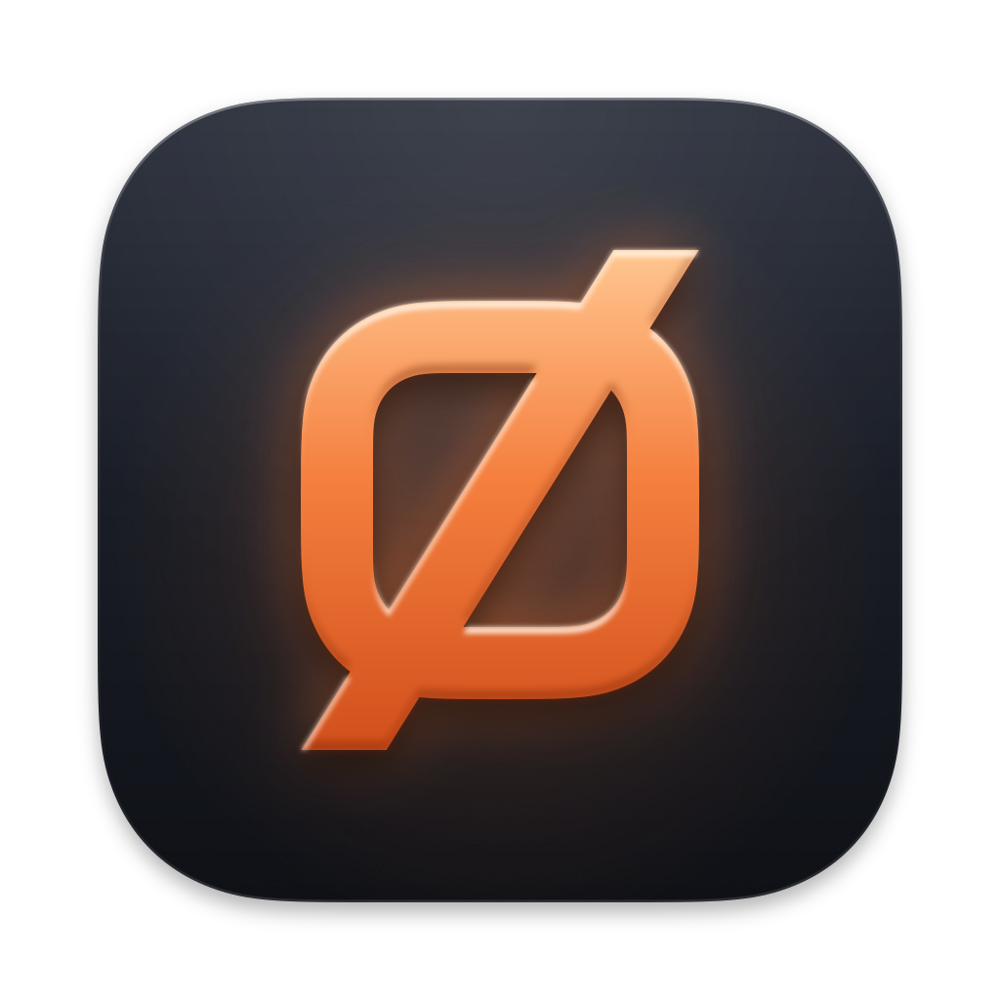

<div align="center">

<br/>

<a href="https://github.com/mrz1836/nilbox"></a>

# Nilbox

**Your GitHub inbox, set to nil.**

One inbox for every repository you touch.<br/>
One click to hand any pull request or issue to a coding agent.

<br/>

<a href="https://github.com/mrz1836/nilbox/releases"></a>
<a href="https://golang.org/"></a>
<a href="#-installation"></a>
<a href="https://github.com/mrz1836/nilbox/blob/master/LICENSE"></a>

<br/>

<table align="center" border="0">
  <tr>
    <td align="right">
       <code>CI / CD</code> &nbsp;&nbsp;
    </td>
    <td align="left">
       <a href="https://github.com/mrz1836/nilbox/actions"></a>
       <a href="https://github.com/mrz1836/nilbox/actions/workflows/frontend.yml"></a>
       <a href="https://github.com/mrz1836/nilbox/actions"></a>
    </td>
    <td align="right">
       &nbsp;&nbsp;&nbsp;&nbsp; <code>Quality</code> &nbsp;&nbsp;
    </td>
    <td align="left">
       <a href="https://codecov.io/gh/mrz1836/nilbox"></a>
    </td>
  </tr>

  <tr>
    <td align="right">
       <code>Security</code> &nbsp;&nbsp;
    </td>
    <td align="left">
       <a href="https://scorecard.dev/viewer/?uri=github.com/mrz1836/nilbox"></a>
       <a href=".github/SECURITY.md"></a>
    </td>
    <td align="right">
       &nbsp;&nbsp;&nbsp;&nbsp; <code>Community</code> &nbsp;&nbsp;
    </td>
    <td align="left">
       <a href="https://github.com/mrz1836/nilbox/graphs/contributors"></a>
       <a href="https://mrz1818.com/"></a>
    </td>
  </tr>
</table>

</div>

<br/>
<br/>

<div align="center">

### <code>Project Navigation</code>

</div>

<table align="center">
  <tr>
    <td align="center" width="33%">
       🚀&nbsp;<a href="#-installation"><code>Installation</code></a>
    </td>
    <td align="center" width="33%">
       ⚡&nbsp;<a href="#-quick-start"><code>Quick&nbsp;Start</code></a>
    </td>
    <td align="center" width="33%">
       ✨&nbsp;<a href="#-features"><code>Features</code></a>
    </td>
  </tr>
  <tr>
    <td align="center">
       🧭&nbsp;<a href="#-how-it-works"><code>How&nbsp;It&nbsp;Works</code></a>
    </td>
    <td align="center">
       📚&nbsp;<a href="#-documentation"><code>Documentation</code></a>
    </td>
    <td align="center">
       🔐&nbsp;<a href="#-security"><code>Security</code></a>
    </td>
  </tr>
  <tr>
    <td align="center">
      🛠️&nbsp;<a href="#-code-standards"><code>Code&nbsp;Standards</code></a>
    </td>
    <td align="center">
      🧪&nbsp;<a href="#-examples--tests"><code>Examples&nbsp;&&nbsp;Tests</code></a>
    </td>
    <td align="center">
      🤖&nbsp;<a href="#-ai-usage--assistant-guidelines"><code>AI&nbsp;Usage</code></a>
    </td>
  </tr>
  <tr>
    <td align="center">
       🤝&nbsp;<a href="#-contributing"><code>Contributing</code></a>
    </td>
    <td align="center">
       👥&nbsp;<a href="#-maintainers"><code>Maintainers</code></a>
    </td>
    <td align="center">
       ⚖️&nbsp;<a href="#-license"><code>License</code></a>
    </td>
  </tr>
</table>

<br/>
<br/>

**Nilbox is a local-first macOS app that turns a GitHub account spread across hundreds of
repositories into one focused inbox. It shows what needs *you*, hides the noise, and opens any
pull request or issue in Claude Code or OpenAI Codex, already in the right clone, worktree, account,
and prompt.**

GitHub's notifications stop scaling after a few dozen repositories. Across 200+ repos in personal
accounts and organizations, review requests, mentions, assignments, and bot noise land in one
unranked pile, and acting on any of it means a context switch: find the clone, check out the
branch, open a terminal, start an agent, retype the prompt. Nilbox handles both: it filters out
the noise, and it launches the agent for you. Your triage state stays on your machine and never
touches GitHub.

<br/>
<br/>

```
                                   YOUR MAC
  ┌─────────────────────────────────────────────────────────────────────────┐
  │                                                                         │
  │  ┌──────────────────────────────┐        ┌───────────────────────────┐  │
  │  │  NILBOX                      │        │  iTerm2 / Terminal.app    │  │
  │  │                              │        │                           │  │
  │  │  Inbox                       │  Open  │  worktree pr-42 of        │  │
  │  │   ├─ Review requested        │   in   │  example-repo             │  │
  │  │   ├─ Authored                │ Claude │  claude  or  codex        │  │
  │  │   └─ Assigned                │───────►│    profile · model ·      │  │
  │  │                              │or Codex│    effort · your prompt   │  │
  │  │  snooze · dismiss · pin      │        │                           │  │
  │  │  (local SQLite, never sent)  │        └───────────────────────────┘  │
  │  └───────────────▲──────────────┘                                       │
  │                  │                                                      │
  └──────────────────┼──────────────────────────────────────────────────────┘
                     │  GraphQL + REST reads, and the edits you ask for
                     │  your gh CLI token, held in memory
            ┌────────┴─────────┐
            │  api.github.com  │
            └──────────────────┘
```

<br/>

## 🚀 Installation

Nilbox is a native macOS app, built from source with one command.

> **Platform:** macOS 13 or newer. Linux and Windows are on the [roadmap](#support--roadmap).

**Requirements**

- **macOS 13+** with the Xcode Command Line Tools (`xcode-select --install`)
- **[Go](https://go.dev/dl/) 1.26+**, **Node 26**, and **pnpm** at the pinned version (`npm install -g pnpm@12.16.1`)
- **[MAGE-X](https://github.com/mrz1836/mage-x)**: `go install github.com/mrz1836/mage-x/cmd/magex@latest`
- **[GitHub CLI](https://cli.github.com)**, signed in with the `repo` and `read:org` scopes (add the
  optional `read:project` scope to see the projects your issues are in)
- To launch sessions: the **Claude Code CLI** (`claude`), the **Codex CLI** (`codex`), or both, and
  **iTerm2** or Terminal.app

```bash
git clone https://github.com/mrz1836/nilbox.git && cd nilbox
magex app:run      # build bin/Nilbox.app and open it
```

After that, `magex app:open` reopens the build, and `magex app:run` rebuilds after you pull. The
Wails CLI is never installed: the build runs it with `go run` at the version `go.mod` pins.

<details>
<summary><strong>Signing, firewalls, and where your data lives</strong></summary>
<br/>

- **Signing:** `magex app:build` signs the bundle ad hoc, which is enough to run it on the Mac that
  built it.
- **Firewalls:** a per-app firewall must let `bin/Nilbox.app/Contents/MacOS/nilbox` reach
  `api.github.com`, or every refresh times out. Blocking `avatars.githubusercontent.com` only
  swaps your profile picture for your initial.
- **Data:** everything lives in `~/Library/Application Support/Nilbox`, readable only by you. The
  database is `nilbox.db` (SQLite, WAL mode), and a copy is saved before each schema migration
  (the three newest are kept). Your prompts and launch defaults are also kept in `prompts.json`
  and `launch-defaults.json` beside it, rewritten after every change, so they survive an update
  or a damaged database. The review sheet keeps the diffs of pull requests you open in it there
  too, capped at 64 MB and dropped after 14 days unused. GitHub tokens are never stored there or
  anywhere else.

Full setup and every build target: [docs/desktop.md](docs/desktop.md#build-targets).

</details>

<br/>

## ⚡ Quick Start

Five steps, in the order you'll use them.

<br>

### Connect GitHub

```bash
gh auth login                     # Nilbox borrows this login; it needs the repo and read:org scopes
gh auth refresh -s read:project   # optional: show each issue's project and its status there
gh auth status                    # confirm you're signed in, and see the token's scopes
```

Nilbox reads the token with `gh auth token` and keeps it in memory only, for up to ten minutes; it
asks `gh` again sooner when GitHub refuses the token or you switch accounts with `gh auth switch`.
`read:project` is read-only and optional: without it everything works, issue cards just leave
their projects out, and the inbox offers the command until you close the tip. **Settings →
Account** shows whether projects are on.

<br>

### Work the inbox

The **Inbox** tab shows three lists: **Review requested**, **Authored**, and **Assigned**, drawn
from every repository your account can see and refreshed every five minutes. **Snooze** an item
(3 days by default), **dismiss** it, or **pin** it to the top. Each card's **⋯** menu gathers
those, opens or copies the item's link, and, when you're assigned or asked to review, takes you
off it on GitHub. Press **⌘F** to filter the inbox: type a few words, or pick `repo:`, `label:`,
`author:`, and more from the field's list.

Click a pull request's title to review it without leaving the app: its diff, description, checks,
and what it still needs to merge, then one button to approve, merge, or ask for changes, pinned to
the commit you saw. Every merge asks first.

<br>

### Launch a coding agent

Click **Open in Claude** (or **Open in Codex**) on any card. Nilbox finds the item's local clone
under `~/projects`, gives the item its own `pr-<n>` or `issue-<n>` worktree beside it, opens a
terminal there, and starts the agent with your prompt loaded. Use the launch menu instead to switch
agents for one launch, pick the prompt, profile, model, effort, and plan mode, and save the choices
as the repository's or org's defaults.

<br>

### Make the prompts yours

The **Prompts** tab starts with **Review**, **Work on it**, **Quick look**, and **Fix checks**.
Edit them or write your own as Go templates (`{{.Title}}`, `{{.URL}}`, …), with a live preview
filled in from a real inbox item. **Review replies** beside them hold the text a review starts
with, such as **LGTM** for people and **Update OK** for dependency bots.

<br>

### Clean up finished worktrees

The **Worktrees** tab lists every linked worktree under your clone root. **Clean up** removes one
only when nothing would be lost, and a background sweep does it for you once the pull request
merges or the issue closes. **Clean up merged branches…** clears out the local branches of pull
requests that merged, never touching `main`, `master`, or any branch you protect.

<br/>

> 📖 **For how every feature behaves, see the [Desktop Guide →](docs/desktop.md)**

<br/>

## ✨ Features

- **One inbox, every repository** — Review requested, Authored, and Assigned, across every repo your account can see
- **Filter as you type** — one toolbar field narrows the inbox, the worktrees, or the settings at once, without a request to GitHub
- **Cards that answer "is it ready?"** — checks, reviews, comments, size grade, labels, and Draft, Conflicts, and Auto-merge tags
- **Issue projects** — each issue's GitHub project, its status and priority and size there, and its sub-issue progress, one click from the board, plus a status sort in your own order
- **Local triage** — snooze, dismiss, or pin; wake rules end a snooze early when something changes
- **Review without leaving** — a pull request's diff, checks, and what it still needs in one sheet; approve, merge, request changes with line comments, update the branch, or close it with a comment, each pinned to the commit you saw and never going past branch protection unless you choose to
- **Edits when you ask** — take yourself off an item's assignees or a pull request's reviewers from the card's menu, paced within your API budget
- **One-click agent launch** — Claude Code or OpenAI Codex in iTerm2 or Terminal.app, in the item's own worktree
- **Follow every session** — each card shows what its agent is doing (working, waiting for your approval, done) and what it last said, with Show in terminal and Resume, read from the agent on your Mac
- **Profiles per repo or org** — every `~/.claude-<name>` and `~/.codex-<name>` config directory is a profile, so each repo launches on its own account
- **Prompt library** — Go templates with highlighting, autocomplete, error checking, and a live preview, plus review replies for the text a review starts with
- **Trust guardrails** — outside contributors launch in plan mode (Codex: read-only), and changes to sensitive files are flagged
- **Worktrees Nilbox keeps track of** — one per item, shared by every agent, resumed on the next launch, and removed only when nothing would be lost
- **Menu bar and notifications** — a live count in the menu bar and native banners for what's new
- **API budget gauge** — an always-visible, live dial for the GitHub budget closest to running out, counting every request the app makes
- **Release in two clicks** — Scripts → Release lists every clone with unreleased changes; the sheet checks the clone, origin, and GitHub, names the exact version, and has magex tag and push it, in Nilbox or your terminal, then confirms GitHub has the tag and follows its release workflow until the release is published. A merge in the review sheet offers it too
- **Your release tools, found and kept current** — mage-x and go-pre-commit found the way your terminal finds them, checked for updates once a day, updated by their own `magex update:install` or `go-pre-commit update` where they can update themselves, and otherwise installed from their GitHub release after a checksum check, never with `go install` or `sudo`
- **Inbox nil** — empty every list and the inbox throws you a party

<br/>

### Feature details

<details>
<summary><strong><code>Inbox</code></strong></summary>
<br/>

- **Three lists**, each a GitHub search across every repository your account can see:
  **Review requested** (open pull requests that ask for your review), **Authored** (your open
  pull requests), and **Assigned** (open issues and pull requests assigned to you). Each shows up
  to 100 items, with **N of M** when GitHub matched more.
- **Compact cards:** the title with **Draft**, **Conflicts**, and **Auto-merge** tags (click a
  pull request's title to review it, or the **↗** beside it to open GitHub); the repository,
  author, and age; then checks passed out of those that ran, reviews, comments, a size grade with
  lines, files, and commits, and the first labels in their GitHub colors.
- **Issue projects:** an issue's card names the GitHub project it is in, with its status there
  in the project's color and its priority and size beside it; hover it for every other field
  (estimate, phase, dates, iteration), and click it to open the board. An issue with sub-issues
  shows how many are done, as `6/8` with a small bar. Projects need the optional, read-only
  `read:project` scope (`gh auth refresh -s read:project`); without it the inbox works as before
  and offers the command until you close the tip. Sub-issue progress needs nothing extra.
- **Sort by status:** flip **Assigned** from **Recent** to **Status** to see work in progress
  above work that's ready, new, or deferred. Every project names its own statuses, so the order
  is yours to arrange; statuses you haven't placed are placed by their names.
- **Always current:** a refresh on start and every five minutes, a manual refresh, and a per-card
  refresh that costs one API point. Archived repositories, and items merged or closed since GitHub
  indexed them, never show.
- **Tab counts and collapsible lists:** the Inbox tab counts each item that needs you once, and a
  collapsed list stays collapsed across launches.
- **Filter:** the toolbar's field (**⌘F** or **/**) narrows every list as you type, by words in
  the title, repository, number, branch, author, and labels, or by GitHub-style keys such as
  `is:pr`, `repo:`, `label:`, `author:@me`, `status:`, and `checks:failing`, offered with counts
  as you type. Matches are marked in the titles, and a card's repository, author, and labels
  filter by themselves when clicked. It searches what's already in the window, so it asks GitHub
  nothing.

More in [Inbox cards](docs/desktop.md#inbox-cards), [Issue projects](docs/desktop.md#issue-projects),
and [Filtering](docs/desktop.md#filtering).

</details>

<details>
<summary><strong><code>Triage, kept local</code></strong></summary>
<br/>

- **Snooze** an item for 1 to 30 days (3 by default), **dismiss** it until you restore it, or
  **pin** it to the top of its lists. A toast confirms each snooze or dismissal, with **Undo**.
- **Wake rules** end a snooze early when new commits, reviews, or comments reach your thresholds,
  and the card says why, as in **Back early: approved, 2 new commits**.
- **Inbox nil:** empty every list and the inbox celebrates with confetti. With Reduce motion on, it
  holds still.
- Snoozes, dismissals, and pins live in the local database. GitHub never hears about them.

More in [Snooze, dismiss, and pin](docs/desktop.md#snooze-dismiss-and-pin).

</details>

<details>
<summary><strong><code>The item menu and edits on GitHub</code></strong></summary>
<br/>

- **One menu per card:** the **⋯** beside the triage buttons opens a pull request in the review
  sheet (**Review…**), opens the item on GitHub, copies its link, gathers the triage actions under
  **Inbox actions** (with a submenu of snooze lengths), and holds the edits below. The hover
  buttons stay for one-click triage, and the menu works from the keyboard like any Mac menu.
- **Unassign me** takes you off an item assigned to you, and **Remove me as reviewer** takes back
  a pull request's request for your review. A request made only to a team says so instead, since
  GitHub removes a team's request for every member or none.
- **Checked, then shown:** each of these edits is one REST request, and the card changes only once
  GitHub's answer confirms it. The item stays out of that list while GitHub's search catches up.
- **Your account only:** an edit goes out only with the token of the account whose inbox you
  see, so a `gh auth switch` never sends one for the wrong person.
- **Within your budget:** edits are counted in the API budget, paced at 30 a minute and 200 an
  hour, well under GitHub's limits on writes (80 and 500), held while REST is down to its last
  hundredth, and paused as long as GitHub asks.

More in [The item menu and edits on GitHub](docs/desktop.md#the-item-menu-and-edits-on-github).

</details>

<details>
<summary><strong><code>Reviewing a pull request</code></strong></summary>
<br/>

- **One sheet:** click a pull request's title for its files and diffs, its description (rendered
  with no remote images), its checks with the required ones marked, each reviewer's latest review,
  a one-line readiness sentence such as **An approval · checks running · auto-merge available**,
  and, for a dependency bot, what it bumps (`golang.org/x/net 0.30.0 → 0.31.0 · minor`). **←**
  and **→** step through the list it came from.
- **One button:** it runs the action that fits, and says what it does: **Approve & squash-merge**,
  **Approve & auto-merge**, **Merge**, **Update branch**, **Ask Dependabot to rebase**, or
  **Comment** when checks fail. Its menu lists every action, with why one can't run now, and
  offers **Ask Dependabot to rebase** on every open Dependabot pull request, for one behind its
  base or in conflict with it, and
  **Update branch** whenever GitHub lets you, whatever the merge state. Neither is the button
  unless the rules hold the pull request back for being behind (or, for the rebase, it has
  conflicts); with nothing else to run, the button reads **Choose an action** and opens the menu.
- **Every merge asks first,** with the methods the repository allows and any warnings to accept.
  Approve, Comment, Request changes, and Update branch are one click (Update branch asks first on
  a Dependabot pull request, which Dependabot stops rebasing once someone else changes it).
- **Close without merging:** the menu offers **Close pull request** wherever GitHub says you may
  close it. It is never the button: picking it asks first, and it posts the text you wrote and
  your line comments as a comment before it closes, once it checked that nothing was pushed.
- **Safe by construction:** every write is pinned to the commit you saw: a merge after a push is
  refused, and an approval checks nothing was pushed before it goes, so you never approve code
  you didn't see. A fresh merge-state read comes before every merge, so an admin's
  token never merges past branch protection on its own; **Merge past the rules** does, only
  from the menu, with each rule it skips to accept. No agent ever approves, merges, or closes.
- **Line comments and suggestions** on the diff, checked against it before GitHub sees them, and
  a draft per pull request that survives closing the sheet.
- **Open in Claude** (or Codex) from the sheet, and use the latest session's verdict as your
  review's text.
- **Cheap:** opening is instant and free, a refresh with nothing pushed costs one GraphQL point,
  and each write costs one point, plus one to check the head before an approval or a close,
  one to three for the merge-state read before a merge, and one more when your text goes as a
  comment first.

More in [Reviewing a pull request](docs/desktop.md#reviewing-a-pull-request).

</details>

<details>
<summary><strong><code>Launching a coding agent</code></strong></summary>
<br/>

- **Two agents, one button:** **Open in Claude** or **Open in Codex** starts Claude Code or
  OpenAI Codex in a new iTerm2 tab (the default) or Terminal.app window. The agent comes from the
  launch menu's switch, else the repository's or org's launch defaults, else **Settings →
  Launching**, else Claude.
- **The item's clone,** found by matching git remotes one level under your clone root
  (`~/projects` by default).
- **Worktrees by default:** Nilbox makes the item's worktree itself, in Go, at
  `~/projects/.nilbox/worktrees/<repo>/pr-<n>` (or `issue-<n>`), on the pull request's head or the
  default branch. Every agent shares it, so launching on the same item again, with either agent,
  resumes it. Worktrees Claude Code made under a clone's `.claude/worktrees` are found and resumed
  too.
- **Profiles:** `~/.claude` and `~/.codex` are each agent's `default` profile, and each
  `~/.claude-<name>` or `~/.codex_<name>` directory (either separator) becomes that agent's profile
  `<name>`, run with `CLAUDE_CONFIG_DIR` or `CODEX_HOME`. Each org and repository can pick a profile
  per agent, so switching agents still lands on the right account.
- **The launch menu** switches the agent and picks the prompt, profile, model, effort, worktree,
  and plan mode for one launch, shows where each default comes from, previews the exact prompt,
  command, and worktree, and saves the choices as the repository's or org's defaults.
- **Launch defaults** per org and per repository resolve in a
  [fixed order](docs/desktop.md#launch-defaults).
- **No clone yet?** The card offers `gh repo clone` into the clone root, then continues the launch.
  A launch never changes an existing clone's own checkout: no checkout, pull, or reset.
- **No trust dialog:** before each launch the worktree and its clone are marked trusted in the
  profile's own config (Claude Code's `.claude.json`, or Codex's `config.toml`), so the session
  starts straight away.
- **No prompt on the command line:** the prompt goes through a file that the launch script reads.
- **Followed from its card:** every launch gets an ID, and the card shows what the session is
  doing (working, needs approval, needs input, idle, or ended), how long, and what the agent last
  said, read through `claude agents --json` and Codex's local app server. **Show in terminal**
  brings its tab forward, **Resume** reopens one that ended, and the menu bar lists the sessions
  waiting for you. Banners for them are there to turn on.

More in [Coding agents and profiles](docs/desktop.md#coding-agents-and-profiles),
[Launching a session](docs/desktop.md#launching-a-session), and
[Following a session](docs/desktop.md#following-a-session).

</details>

<details>
<summary><strong><code>Prompt library</code></strong></summary>
<br/>

- Prompts are Go `text/template`s with `{{.Title}}`-style variables. Each has a title, a short
  nickname for the launch button, the kinds of item it applies to, and optional launch settings
  (model, effort, plan mode, worktree, and extra flags).
- Four starters, **Review**, **Work on it**, **Quick look**, and **Fix checks**, are yours to
  edit, duplicate, delete, or reset.
- The editor highlights the template and completes variables as you type. It checks the template
  with the same Go package a launch uses, reporting the line and column with "did you mean"
  suggestions, and previews it filled in for a real inbox item beside a cheat sheet of variables.
- Set the default prompt for pull requests and for issues app-wide, per org, or per repository.
- **Review replies** are a second library beside the agent prompts: the text the review sheet
  starts an approval, a request for changes, or a comment with, filled in for the pull request.
  Four starters, and a default for approvals, for bots' pull requests, for changes, and for
  comments. A reply never launches anything.
- Your prompts outlive updates and damaged databases. After every change the library is copied to
  `prompts.json`, and it comes back on its own whenever the database has to start over.
- Export the library, or one prompt, to a [prompt file](docs/prompt-files.md), and import one.
  Before anything changes you see what each prompt would do. **Restore from a backup** brings
  prompts back from any copy the app kept. Importing never changes a prompt you wrote or edited.

More in [Prompts](docs/desktop.md#prompts).

</details>

<details>
<summary><strong><code>Trust and sensitive files</code></strong></summary>
<br/>

- **Outside contributors:** items from forks, people outside the project, and bots not on your
  trusted list (`dependabot`, `github-actions`, and `renovate` by default) launch in plan mode
  (for Codex, a read-only sandbox that asks first), whatever the profile says, unless you opt out
  for that one launch. Their prompts end with a
  fixed line telling the agent to treat the item's text as information, not instructions.
- **Sensitive files:** pull requests from outside contributors and untrusted bots (and from
  collaborators, unless you narrow the check) have their changed files checked against five
  categories: agent configuration, workflows and CI, build and dev tooling, review and merge
  rules, and dependencies. Your own `.gitignore`-style patterns are checked too. The card names
  each category touched and links every file to its diff.
- **Head-commit confirmation:** a launch on a pull request that changes agent configuration, or
  whose files couldn't all be checked, waits until you confirm its exact head commit. A project
  hook added on that branch runs as soon as a session starts, even in plan mode.

More in [Outside contributors](docs/desktop.md#outside-contributors) and
[Sensitive files](docs/desktop.md#sensitive-files).

</details>

<details>
<summary><strong><code>Worktrees</code></strong></summary>
<br/>

- The **Worktrees** tab lists every linked worktree of the clones under your clone root, including
  ones from sessions started outside Nilbox, with the branch, uncommitted files, commits not on
  GitHub, locks, and the age of the last commit.
- Nilbox records each worktree it makes, with the agent and time of its latest session, and checks
  every record against git each time it lists or sweeps: a worktree moved is followed, one removed
  outside the app is forgotten, and one on an item's `worktree-<item>` branch is picked up.
- Worktrees made for a pull request or issue are linked to it, and GitHub is asked whether it is
  done, so each shows as **in use**, **ready to clean up**, or **needs a look**. **In use** means a
  running process, of any agent or tool, works inside it.
- **Clean up** removes a finished worktree only when nothing would be lost: no uncommitted
  changes, every commit on GitHub, and no session running in it. A sweep every five minutes does
  the same once a pull request merges or an issue closes (on by default).
- **Remove**, **Remove all clean**, **Force remove** (for dirty, unlocked worktrees), **Prune**,
  and **Unlock** for an agent lock whose session has ended. The main worktree is never removable, a
  worktree in use is never removed, and a lock you set by hand is never released.
- A worktree whose status can't be read safely, as one whose clone's own git config names a hook,
  a filter, or another program git would run, says why and is never removed or cleaned up.
- Every removal and cleanup asks first, with a box for each worktree and branch it would take,
  ticked as **Settings → Worktrees** says: the worktree's own `worktree-<item>` branch, the pull
  request's branch when a session checked it out, or both. Untick any to keep it. A branch goes
  only when every commit on it is on GitHub, and only while it still points at the commit shown.
- **Clean up merged branches…** finds each clone's local branches whose pull request merged, in a
  few batched GitHub requests, and deletes the ones you tick. Protected branches (`main` and
  `master` by default, plus names or patterns such as `release/*` you add) and each repository's
  default branch are never offered.
- **Recently cleaned up** lists each cleanup, by hand or automatic, with the deleted branch and the
  commit the worktree was at.
- **Filter** the worktrees from the toolbar by branch, path, clone, item, or agent, or by
  `is:dirty`, `is:finished`, and the other states.

More in [The Worktrees view](docs/desktop.md#the-worktrees-view).

</details>

<details>
<summary><strong><code>Scripts, Release, Hooks, and Repo scripts</code></strong></summary>
<br/>

- The **Scripts** tab appears while mage-x or go-pre-commit is on (Settings → Integrations finds
  them, or installs them from their GitHub releases), or while you turn Scripts on there. Its
  badge counts the runs going, with a red dot after a run fails and an amber one while a tool
  that's on can't be used.
- **Release** lists every clone under your clone root whose `origin` is on GitHub, grouped into
  unreleased changes (newest commit first), up to date, no releases yet, and can't release here.
  Each row shows the newest version, the commits since it, the checks on the newest commit, and
  what matters about your clone, such as being on another branch or having uncommitted files.
- **The release sheet** checks the clone, origin, and GitHub before you click: uncommitted
  changes, where your clone is, commits not on GitHub, a version only on your Mac, reaching
  origin, the checks, signing, and more, each with its fix. It lists the commits since the last
  version, offers Patch (always preselected), Minor, or Major, and says exactly what magex will
  do. The button names the version, and everything is checked again under the clone's lock
  before magex runs.
- **Major** needs a magex that can be told which version to make (1.30.0 or later), the exact
  version typed to confirm, and, for a Go module whose `go.mod` doesn't name the new major, a box
  ticked on purpose.
- **Runs in Nilbox or your terminal.** In Nilbox, the sheet follows magex's steps with the live
  log; in iTerm2 or Terminal.app, a signing passphrase can be typed, and Nilbox still follows
  the run. Either way, the result is what GitHub and your clone say once magex ends: the tag on
  GitHub, the branch your clone is back on, or, if the push didn't land, the commands to finish
  or undo it.
- **Followed to published.** Once the tag is on GitHub, Nilbox follows the tag's release
  workflow, at most 20 checks over 45 minutes, and says when the release is published, when
  one of the tag's workflows failed, or why it stopped following, with a banner for the first
  two. It picks up where it left off after a restart.
- **After a merge,** the review sheet's toast offers **Release acme-org/sdk…**, behind a setting
  that's on by default. Nilbox never releases by itself.
- **Hooks** lists every clone with a go-pre-commit config, grouped into needs attention (no hook
  yet, an outdated one, another tool's, or a hooks folder other repositories share), ready, and
  turned off in the repository, with the clones that have no config collapsed below. The rail
  counts the ones that need attention.
- **Install, Update, Reinstall, or Replace…** a clone's hook in one click, or **Install and update
  all** at once. Replacing another tool's hook (husky, pre-commit, lefthook) asks first and names
  where it goes, a hooks folder other repositories share asks before anything changes it, and
  what each action did is read from the hook file afterwards, never from go-pre-commit's exit
  status alone.
- **Run the checks** on every file, the staged ones, or one check. The result says which passed
  and which failed and why, and every file they fixed or staged, including files that already had
  uncommitted changes. The page warns when your shell's PATH won't let the hook find
  go-pre-commit, with the line that fixes it.
- **Repo scripts** lists a clone's own commands: its `t3.json` scripts, the `.vscode/tasks.json`
  tasks Nilbox can run (one it can't, such as a task that uses `${file}`, shows greyed with the
  reason), and magex's targets, the common ones one click away, with an Arguments field for
  `key=value` pairs. A task's inputs open a small form first, and anything that bumps a version
  points to Release, which does it with its checks. Every command runs where your runs go, or,
  from its menu, in the other place. **New script** saves your own commands, shown first, in
  every repository, the Go ones, or those you choose, each with its own place to run and an
  optional ask before running. Beside the branch, the page says whether origin has newer
  commits on it, asking origin about that branch alone (an origin not on GitHub only when you
  click **Check**), and **Pull** fast-forwards it (`git pull
  --ff-only`, never a merge or a rebase), so the scripts run on the newest code. A clone whose
  own git config names a program git would run says it can't be pulled, and why.
- **A command from the repository asks first.** Before a `t3.json` script, a VS Code task, or the
  repository's own magex target runs for the first time, Nilbox shows exactly what will run and
  where, and asks again whenever it changes, showing what you ran before. Nothing in a clone runs
  just to list its commands. Settings → Integrations chooses which sources the page reads.
- **Runs** lists every release, hooks action, check, script, pull, and tool update, with each run's
  status, result, and full log.

More in [The Scripts tab](docs/desktop.md#the-scripts-tab), [Release](docs/desktop.md#release),
[Hooks](docs/desktop.md#hooks), and [Repo scripts](docs/desktop.md#repo-scripts).

</details>

<details>
<summary><strong><code>Menu bar and notifications</code></strong></summary>
<br/>

- A **menu bar icon** shows how many items need you. Its menu lists up to five items per list,
  refreshes the inbox, and opens any item in the window. While the icon is shown, closing the
  window keeps Nilbox running in the menu bar.
- **Native banners** announce new review requests, new assignments, snoozes that end early,
  releases you started that reach GitHub, are published, or whose release workflow fails, and
  runs from the Scripts tab that fail, each kind with its own switch. More than three at once are
  summed up in one banner.
- A **notification history** behind the toolbar's bell keeps the newest 200.

More in [Menu bar and notifications](docs/desktop.md#menu-bar-and-notifications).

</details>

<details>
<summary><strong><code>Settings, themes, and the API budget</code></strong></summary>
<br/>

- **API budget gauge:** an always-visible dial that follows whichever GitHub budget has the least
  left (GraphQL, REST core, or search), since every tool on your machine shares them. It updates
  with every GitHub response the app gets, at no extra cost, and the open panel re-reads the
  budgets every 30 seconds for free. Click it for each budget's remaining points, its reset time,
  how much Nilbox spent versus everything else signed in as you, what a refresh costs for the
  items you track, and the edits it made for you in the last hour. The counts survive a restart.
- **Themes:** follow the system, or pin Light or Dark. The native window frame and menus follow.
- **Text size:** 100%, 115%, or 130%, apart from the window's size. Text and the spacing around
  it scale together, so nothing clips.
- **Settings** covers your account, appearance, notifications, snoozing, reviewing, launching,
  worktrees, profiles, repositories, trust, sensitive files, and integrations. **Find a
  setting** in the toolbar narrows the sections to those with a match and marks the setting.
- **About** shows the version, build, commit, and system, each coding agent's installed
  version, and the GitHub CLI's, and **Report a bug** opens a GitHub issue with those details
  filled in.

More in [The window](docs/desktop.md#the-window).

</details>

<br/>

### Support & roadmap

| Feature                              | Status        | Description                                                         |
|--------------------------------------|---------------|---------------------------------------------------------------------|
| ✅ macOS 13+                          | **Supported** | Native desktop app with a menu bar icon and notification banners    |
| ✅ Claude Code                        | **Supported** | Your own profiles, models, effort, and flags                        |
| ✅ OpenAI Codex                       | **Supported** | The same, with a switch on each launch and defaults per repo or org |
| ✅ iTerm2 and Terminal.app            | **Supported** | iTerm2 by default                                                   |
| ✅ mage-x and go-pre-commit           | **Supported** | Releases, Git hooks, and repository scripts in the Scripts tab      |
| 🚧 First-run setup                   | **Planned**   | A GitHub CLI check, plus agent and terminal preferences             |
| 🚧 Mute or pin repositories and orgs | **Planned**   | Hide or raise everything from a repository or org at once           |
| 🚧 Security alert sweeps             | **Planned**   | Sweep security alerts across every repository                       |
| 🚧 More coding agents and terminals  | **Planned**   | Beyond Claude Code, Codex, iTerm2, and Terminal.app                 |
| 🚧 More integrations                 | **Planned**   | Beyond mage-x and go-pre-commit                                     |
| 🚧 Linux and Windows                 | **Planned**   | The core is plain Go and already builds and tests on Linux          |

<br/>

## 🧭 How It Works

| Layer             | Details                                                                                                                                                                                                  |
|-------------------|----------------------------------------------------------------------------------------------------------------------------------------------------------------------------------------------------------|
| **Desktop shell** | [Wails v3](https://wails.io): a Go backend in the native macOS webview. Everything but the window is plain Go, built and tested on Linux without CGO                                                     |
| **Frontend**      | React, TypeScript, Vite, and Tailwind, reaching Go only through generated bindings                                                                                                                       |
| **GitHub access** | Your [GitHub CLI](https://cli.github.com) token, held in memory only, for up to ten minutes. One GraphQL request carries all three searches; card details load by node ID in concurrent batches          |
| **API budget**    | A 43-item inbox refreshed every five minutes spends 1.2% of the hourly GraphQL budget                                                                                                                    |
| **Storage**       | SQLite through a pure-Go driver, with sqlc-generated queries and forward-only, checksummed migrations, each after a backup                                                                               |
| **Agents**        | The Claude Code and Codex CLIs you already use, with your own profiles. Nilbox never stores model credentials and never reads an agent's sign-in                                                      |
| **Worktrees**     | Made, resumed, and tracked in Go, one per item per clone and shared by every agent; the launch script only changes into the folder and starts the agent                                                 |

<br>

> **Your data stays on your Mac.** Nilbox talks only to GitHub: `api.github.com`,
> `avatars.githubusercontent.com` once for your profile picture, and, when you install or update a
> tool, `github.com` and GitHub's release download hosts for that tool's public release, with no
> token and nothing of yours. It reads from GitHub, and changes
> something there only when you ask: taking you off an item, or a review, comment, merge,
> auto-merge, branch update, Dependabot rebase request, or close you send from the review sheet.
> Repo scripts' branch check and **Pull** run git against a clone's own origin, and ask an origin
> that isn't on GitHub only when you click **Check**. Your preferences, triage state, and cache,
> the diffs of pull requests you review included, never leave your machine.

<br/>

## 📚 Documentation

View the full documentation for Nilbox:

| Document                                                   | Description                                                                         |
|------------------------------------------------------------|-------------------------------------------------------------------------------------|
| **[Desktop Guide](docs/desktop.md)**                       | Setup, build targets, data location, and how every feature behaves                  |
| **[Performance](docs/performance.md)**                     | Measured startup, refresh, launch, size, and API budget, and how to reproduce them  |
| **[CLAUDE.md](CLAUDE.md)**                                 | Nilbox's own rules, the gate every change passes, and the layout                    |
| **[AGENTS.md](.github/AGENTS.md)**                         | The shared engineering rulebook for contributors and AI agents                      |
| **[Tech Conventions](.github/tech-conventions/README.md)** | Commits, branches, pull requests, testing, releases, and security practices         |
| **[Support](.github/SUPPORT.md)**                          | Questions, bug reports, and private contact                                         |

<br/>

## 🔐 Security

### Important Disclaimer

> ⚠️ **Experimental Software — Use at Your Own Risk**
>
> Nilbox is open-source software provided "AS-IS" without warranty. By using it, you acknowledge:
>
> - **Agents act on your machine:** a launched coding agent runs with your profile's permissions
>   and can run commands and change files in your clones.
> - **Untrusted content stays untrusted:** pull requests and issues from outside contributors can
>   carry prompt injection. Plan mode (Codex's read-only sandbox) for outsiders and the
>   sensitive-file checks reduce that risk; they don't remove it.
> - **Tools you install run on your Mac:** Nilbox installs mage-x and go-pre-commit only from
>   their GitHub releases, after checking the release's checksums, into `~/.local/bin`, and never
>   with `go install` or `sudo`. A copy that can update itself is updated by its own updater
>   (`magex update:install`, `go-pre-commit update`), which checks the release's checksums too;
>   Nilbox never runs it for a copy in a go install folder (`$GOBIN`, `$GOPATH/bin`, or
>   `~/go/bin`, as your shell and `go env` set them), where magex's would run `go install`.
>   Those tools then fetch what they need themselves: before 1.14.0,
>   go-pre-commit installs its own linters with `go install` and `curl`, which Nilbox can't check.
> - **Repository commands run as you:** a `t3.json` script, a VS Code task, or a magex target runs
>   in its clone with your permissions, and magex reads the repository's code and `.github/env`
>   settings. Nilbox asks before a command from the repository's files first runs and whenever it
>   changes; read it before you say yes.
> - **No formal audit:** Nilbox has not been professionally audited.
> - **No liability:** the authors accept no responsibility for lost work, exposed data, or damages.
>
> **Review what you launch, especially from people you don't know.**

For security issues, see our [Security Policy](.github/SECURITY.md) or contact:
[nilbox@mrz1818.com](mailto:nilbox@mrz1818.com)

<br/>

### Additional Documentation & Repository Management

<details>
<summary><strong><code>Development Setup (Getting Started)</code></strong></summary>
<br/>

Install the [MAGE-X](https://github.com/mrz1836/mage-x) build tool and the
[go-pre-commit](https://github.com/mrz1836/go-pre-commit) hooks
([install guide](.github/tech-conventions/pre-commit.md)), then the frontend toolchain:

```bash
go install github.com/mrz1836/mage-x/cmd/magex@latest   # build tool
go-pre-commit install                                   # git hooks, run from the repo root
npm install -g pnpm@12.16.1                             # once, at the version frontend/package.json pins
magex frontend:install                                  # frontend dependencies, exactly as the lockfile pins them
```

Node must be version 26 (`frontend/.nvmrc`). Full prerequisites are in the
[Desktop Guide](docs/desktop.md#prerequisites).

</details>

<details>
<summary><strong><code>Build Commands</code></strong></summary>
<br/>

View all build commands:

```bash
magex help
```

Common commands:

```bash
magex build          # build the headless binary
magex app:dev        # run the desktop app with a hot-reloading frontend
magex app:build      # build the macOS app bundle
magex app:run        # build the app, quit the running copy, and open the new build
magex test           # run the Go test suite
magex lint           # run golangci-lint
magex format:fix     # format the code
magex frontend:gate  # format check, lint, typecheck, and test the frontend
magex db:generate    # regenerate the typed queries after changing a query or migration
```

Before opening a pull request, run the full gate:

```bash
magex format:fix && magex lint && magex test:race && go-pre-commit run --all-files
magex frontend:gate
magex db:check       # the generated queries are current and every query prepares
magex app:check      # macOS: bindings drift check, desktop lint, desktop tests, and bundle build
```

</details>

<details>
<summary><strong><code>Project Layout</code></strong></summary>
<br/>

| Path              | Purpose                                                                                                                         |
|-------------------|---------------------------------------------------------------------------------------------------------------------------------|
| `cmd/nilbox/`     | Entry point: a headless build by default, and the desktop app (window, menu bar icon, banners) with the `desktop` tag          |
| `internal/brand/` | Product identity and design tokens; `internal/brandgen/` generates the theme, `Info.plist`, and icon artwork from it            |
| `internal/`       | The bound services (inbox, review, launcher, prompts, launch defaults, settings, profiles, worktrees, notifications, sessions, the API budget, integrations, script runs, release, hooks, and repository scripts) and their building blocks |
| `frontend/`       | The React + TypeScript frontend and its generated Go bindings                                                                   |
| `build/`          | App and menu bar icon artwork, and the macOS bundle's `Info.plist` and icon set                                                 |
| `magefiles/`      | Custom `magex` targets for the brand, the frontend, the app, the database queries, and measurements                             |
| `docs/`           | The Desktop Guide and measured performance                                                                                      |
| `.github/`        | CI workflows, community docs, and engineering conventions                                                                       |

</details>

<details>
<summary><strong><code>Releases</code></strong></summary>
<br/>

This project uses [goreleaser](https://github.com/goreleaser/goreleaser) to publish releases to
GitHub. To get started, install it via:

```bash
brew install goreleaser
```

The release process is defined in the [.goreleaser.yml](.goreleaser.yml) configuration file. Then
create and push a new Git tag using:

```bash
magex version:bump bump=patch push=true branch=master
```

The tag triggers [fortress-release.yml](.github/workflows/fortress-release.yml), which publishes the
release and its changelog. `magex app:build` stamps the app with the same version, build number,
and commit, all shown in Settings → About.

</details>

<details>
<summary><strong><code>GitHub Workflows</code></strong></summary>
<br/>

Nilbox uses the **Fortress** workflow system for its Go CI/CD, plus a dedicated frontend gate:

- **fortress-test-suite.yml** — Complete Go test suite, built on Linux without CGO
- **fortress-code-quality.yml** — Code quality checks (gofmt, golangci-lint, staticcheck)
- **fortress-security-scans.yml** — Security scanning with gitleaks, govulncheck, and Nancy
- **fortress-coverage.yml** — Code coverage reporting to Codecov
- **fortress-release.yml** — Automated releases via GoReleaser
- **frontend.yml** — The frontend gate (`magex frontend:gate`): install, format check, lint, typecheck, tests, and the render check
- **sqlc.yml** — Checks that the generated queries match their SQL and that every query prepares

The desktop shell needs macOS, so `magex app:check` runs locally. See all workflows in
[`.github/workflows/`](.github/workflows/).

</details>

<details>
<summary><strong><code>Updating Dependencies</code></strong></summary>
<br/>

To update all Go dependencies (Go modules, linters, and related tools), run:

```bash
magex deps:update
```

Frontend dependencies are pinned by `frontend/pnpm-lock.yaml`, and
[Dependabot](.github/dependabot.yml) keeps Go modules, GitHub Actions, and the dev container
current.

</details>

<br/>

## 🧪 Examples & Tests

All tests run via [GitHub Actions](https://github.com/mrz1836/nilbox/actions) and use
[Go version 1.26](https://go.dev/doc/go1.26). View the
[Go configuration](.github/workflows/fortress.yml) and the
[frontend configuration](.github/workflows/frontend.yml).

Run all Go tests (fast):

```bash
magex test
```

Run all Go tests with race detector (slower):

```bash
magex test:race
```

Run the frontend gate (format check, lint, typecheck, tests with coverage, and the render check):

```bash
magex frontend:gate
```

<br/>

### Test Coverage

View coverage report:

```bash
magex test:coverage
```

Coverage reports are automatically uploaded to [Codecov](https://codecov.io/gh/mrz1836/nilbox) on
every commit.

<br/>

### Performance

Measured on an Apple Silicon Mac (M1 Max) running macOS 15, against the production bundle
`magex app:build` produces:

| Metric                         | Target  | Measured |
|--------------------------------|--------:|---------:|
| Cold start to first paint      |   < 1 s |   0.54 s |
| Inbox refresh                  |   < 3 s |   2.30 s |
| App binary size                | < 30 MB |  21.7 MB |
| API budget at 5-minute cadence |   < 2 % |   1.20 % |

Re-measure everything (size, startup, live read-only refreshes, and a real launch in iTerm2):

```bash
magex measure:all
```

> Numbers are local-machine baselines, not SLOs. Use them to spot regressions on the same
> hardware after a change. The method, every run, and how to reproduce them are in
> [docs/performance.md](docs/performance.md).

<br/>

## 🛠️ Code Standards

Read more about this Go project's [code standards](.github/CODE_STANDARDS.md).

<br/>

## 🤖 AI Usage & Assistant Guidelines

Read the [AI Usage & Assistant Guidelines](.github/CLAUDE.md) for details on how AI is used in this
project and how to interact with AI assistants, and [CLAUDE.md](CLAUDE.md) for the rules every
assistant follows in this repository.

<br/>

## 👥 Maintainers

| [](https://github.com/mrz1836) |
|:------------------------------------------------------------------------------------------------:|
|                                [MrZ](https://github.com/mrz1836)                                 |

<br/>

## 🤝 Contributing

View the [contributing guidelines](.github/CONTRIBUTING.md) and please follow the
[code of conduct](.github/CODE_OF_CONDUCT.md). Before your first pull request, read
[CLAUDE.md](CLAUDE.md) for Nilbox's own rules and the gate every change passes, and
[AGENTS.md](.github/AGENTS.md) for the conventions on code, tests, commits, branches, and pull
requests that both humans and AI agents follow here.

### Keep private names out of the repository

Nilbox is public, so nothing committed here may name your employer, your clients, or your
private organizations and repositories. The guard tests can check that for you: list those names
in your clone's private-terms file, and `magex test` fails wherever one appears.

Create or edit the file (it lives inside `.git`, so it works from any worktree of your clone):

```bash
"${EDITOR:-vi}" "$(git rev-parse --path-format=absolute --git-common-dir)/info/private-terms"
```

```text
# One term per line. Blank lines and lines starting with # are ignored.
your-employer
your-client-org
an-internal-codename
```

- **Matching** ignores case and finds whole words only: `acme` matches `Acme`, `acme-org`, and
  `acme_api`, but not `acmetools` or `AcmeClient`. List each form you use, and prefer distinctive
  names over common words, which would flag ordinary text.
- **What it checks:** the contents and path of every file (tracked files, plus untracked files
  that aren't ignored), the current branch name, and every commit that no remote has yet. A
  failure lists each `file:line` or commit to fix.
- **Run it** with the rest of the suite (`magex test` or the full gate), or on its own with
  `go test ./internal/repoguard -run PrivateTerms -v`.
- **It stays on your machine.** Git never commits anything inside `.git`, and CI, which has no
  such file, skips the check.

### How can I help?

All kinds of contributions are welcome :raised_hands:!
The most basic way to show your support is to star :star2: the project, or to raise issues :speech_balloon:.
You can also support this project by [becoming a sponsor on GitHub](https://github.com/sponsors/mrz1836) :clap:
or by making a [**bitcoin donation**](https://mrz1818.com/?tab=tips&utm_source=github&utm_medium=sponsor-link&utm_campaign=nilbox&utm_term=nilbox&utm_content=nilbox)
to ensure this journey continues indefinitely! :rocket:

[](https://github.com/mrz1836/nilbox/stargazers)

<br/>

## 📝 License

[](LICENSE)
